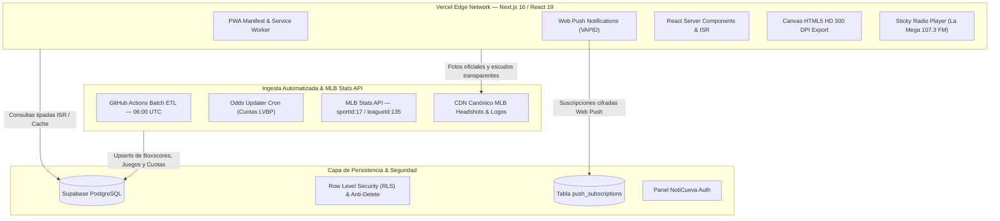

# REPUBLICARAQUISTAPP 🦁⚾

> **Plataforma Web y Progressive Web App (PWA) Sabermétrica de Alto Rendimiento para la Liga Venezolana de Béisbol Profesional (LVBP), con enfoque analítico en los Leones del Caracas.**

[](https://republicaraquistapp.vercel.app/)
[](https://nextjs.org/)
[](https://react.dev/)
[](https://tailwindcss.com/)
[](https://supabase.com/)
[](#-notificaciones-web-push-pwa)

---

## 🌟 Visión Arquitectónica

**REPUBLICARAQUISTAPP** implementa una arquitectura nativa de borde (Edge-first) con renderizado híbrido reactivo, garantizando tiempos de respuesta ultrarrápidos (TTFB < 50ms), sincronización relacional en tiempo real con Supabase y streaming continuo de datos desde la MLB Stats API.



- **Frontend en Vercel:** Next.js 16.3.6 (Turbopack) con React 19, Tailwind CSS v4, temas Dark Navy (`#070B19`), Tarjetas Glassmorphism (`#0D152B`) y acentos oficiales Dorado Caraquista (`#FDB827`).
- **PWA Instalable con Notificaciones Push:** Experiencia nativa completa en móviles y escritorio con service worker, manifest, suscripción a Web Push (VAPID) y alertas automáticas de inicio de partido y carreras clave.
- **Audio Streaming en Vivo:** Circuito radial oficial persistente con streaming directo de **La Mega 107.3 FM (Unión Radio)** para escuchar la transmisión de los Leones del Caracas sin cortar la navegación.
- **Herramientas de Comunidad & Web Share:** Compartir directo en WhatsApp, X, Telegram o portapapeles en la cabecera, barra móvil y Game Center.
- **Persistencia & Seguridad (RLS):** Supabase PostgreSQL blindado con Row Level Security (RLS) en todas las tablas, prevención estricta de borrado accidental (`DELETE`) contra accesos anónimos y proxy seguro.
- **CDN Canónico de Fotos:** Headshots oficiales de peloteros servidos en alta resolución desde el CDN de MLB (`img.mlbstatic.com`) y TuJonrón con siluetas de fallback.

---

## ⚾ Suite Completa de Vistas Sabermétricas & Módulos en Vivo

| Ruta | Módulo | Descripción y Capacidades Sabermétricas |
| :--- | :--- | :--- |
| `/` | **Centro de Mando** | Scoreboard en vivo cara a cara, series particulares contra cada rival de la LVBP, desglose canónico Día (< 18:00 VET) y Noche (≥ 18:00 VET), Semanas ISO. Pestaña activa por defecto **"Último Juego"** con marcador detallado y MVP del encuentro (Tango RE24), Tendencias U10J, Líderes del Equipo y Leones Stats. |
| `/game-center` | **Game Center (En Vivo)** | **Segunda pantalla oficial en vivo de Leones del Caracas**: diamante SVG interactivo con corredores en 1B, 2B y 3B, conteo LED (Bolas, Strikes, Outs), duelo en el plato con fotos CDN y métricas en tiempo real, linescore R-H-E por entradas, play-by-play inverso con filtros cromáticos y **Boxscore Oficial con alineación ofensiva 1-9 filtrada sin pitchers** (respetando la regla de Bateador Designado y preservando a corredores emergentes `PR` y bateadores emergentes `PH` sin turnos oficiales), sintonía de TV y botón para activar el Circuito Radial. |
| `/roster` | **Roster Oficial & Coaching Staff** | Nómina semanal oficial de 34 jugadores activos autorizada por la LVBP, clasificada por rol (Lanzadores, Receptores, Infielders, Jardineros) con fotos oficiales transparentes, datos biográficos, más el cuerpo técnico completo liderado por José Alguacil, filtros por posición y buscador por nombre/número. |
| `/standings` | **Posiciones & ELO** | Tabla de clasificación oficial de la LVBP, Expectativa Pitagórica ($xW/xL$ con exponente 1.83), ratings ELO dinámicos y simulador Monte Carlo (5,000 iteraciones) de probabilidades de clasificación a Round Robin y Serie Final. |
| `/calendario` | **Calendario Oficial LVBP 2026-2027** | Cuadrícula interactiva mensual (Octubre, Noviembre, Diciembre), diferenciación cromática de local (blanco) y visitante (dorado `#FDB827`), sincronización en un clic con Google Calendar y Apple Calendar (`webcal://`), badges y logotipos de televisoras y streaming (Televen, Venevisión, IVC, ByM Sport, 1Baseball, SimpleTV, YouTube). |
| `/probabilidades` | **Líneas & Probabilidades (Tipster Hub)** | Proyecciones de partidos (ELO dinámico + delta FIP abridores + bullpen + factores de parque LVBP + Poisson/Skellam), cálculo de Cuotas Justas (Fair Odds), comparador de 4 casas de apuestas de Venezuela (**JuegaEnLínea**, **Betcris**, **SellaTuParley**, **Apuestas Royal**), detector de **Mejor Cuota** y **Cuotas Desfasadas ($EV \ge 12\%$)**, gestión de bankroll con **Quarter-Kelly** y exportador Canvas HTML5 de tarjetas de picks en formato dual HD (Cuadrado 1:1 a 2400x2400 y Vertical 9:16 a 1080x1920 a 300 DPI). |
| `/individuales` | **Líderes Individuales & Fildeo** | Tablas ordenables de bateo y pitcheo tradicional y avanzado (AVG, OBP, SLG, OPS, ISO, BABIP, wOBA, wRC+, ERA, WHIP, FIP, K/9, BB/9, K/BB, IP, SV), pestaña de Fildeo/Defensa (PO, A, E, TC, FPCT, DP, CS, SB) y enlaces directos a perfiles de peloteros. |
| `/matchup` | **Matchup 360** | Comparador Head-to-Head con radar polar de 8 ejes sabermétricos, desglose por categorías (Ofensiva, Volumen, Corrido y Defensa), veredicto algorítmico y exportación de tarjeta descargable en PNG. |
| `/colectivas` | **Estadísticas Colectivas & Stathead** | Rendimiento comparativo de bateo, pitcheo y fildeo entre los 8 equipos de la LVBP con gráficos interactivos en Recharts, totales/promedios de la liga y filtros por rango de fechas estilo Stathead. |
| `/bullpen` | **Bullpen, Carga & Lineups** | Efectividad de relevistas, control de corredores heredados ($IR$, $IRS$, $IRS\%$), retención de ventajas, presupuesto y carga de lanzamientos por relevista (días de descanso) y alineaciones titulares 1 al 9. |
| `/wpa` | **Win Expectancy & WPA** | Curvas interactivas de probabilidad de victoria por encuentro, matriz Tango RE24 de 24 estados, Leverage Index (LI), jugadas de mayor impacto (Clutch) y acumulados de temporada. |
| `/situacional` | **Splits Situacionales, FanGraphs & LOB** | Rendimiento con corredores en posición anotadora (RISP), bases llenas, platoon LHP/RHP, matriz BvP y **Tracker de Dejados en Base (LOB)** con desglose de 3er out y RISP LOB. |
| `/spray-charts` | **Spray Charts & Strike Zone** | Gráficos espaciales de batazos sobre diamante con modelo determinístico de dureza BIS (Hard, Medium, Soft) y mapas de calor 3x3 de disciplina en el plato (O-Swing%, Z-Contact%, SwStr%, CSW%). Prohibición estricta de Statcast en LVBP. |
| `/pitching` | **Pitching Summary & Telemetría** | Buscador universal de lanzadores (MLB/MiLB y Leones del Caracas). Conmutador Salida Individual vs Temporada Completa. Rama MLB (Statcast Hawk-Eye: IVB, HB, Whiff%, Zone%) vs Rama Caracas (Play-by-Play Tango RE24: destinos, carga por entrada y splits LHB/RHB). Exportación de tarjeta oficial cuadrada (2400x2400 px a 300 DPI) estilo Thomas Nestico (@TJStats). |
| `/noticueva` | **NotiCueva por Gilberto Méndez** | Espacio editorial oficial con crónicas de la cueva melenuda, feed oficial de X (@RepubCaraquista), y panel de redacción protegido (`/admin`) con barra de formato enriquecido, vista previa en tiempo real y persistencia relacional en Supabase. |
| *Global* | **Circuito Radial en Vivo (Sticky Player)** | Reproductor flotante persistente con la señal oficial en directo de **La Mega 107.3 FM / Unión Radio** para sintonizar las transmisiones de los Leones del Caracas sin interrumpir la navegación. |
| *Global* | **Notificaciones Web Push (VAPID)** | Sistema de suscripción voluntaria desde el navegador para recibir avisos de inicio de juegos, jonrones decisivos y notas de NotiCueva. |
| *Global* | **Orientación Responsiva Adaptativa** | Experiencia optimizada tanto en modo vertical (Portrait) para teléfonos como horizontal (Landscape) para tabletas y monitores. |

---

## 📡 API Routes y Endpoints Serverless

La plataforma expone un backend serverless optimizado sobre Vercel Edge y Node.js runtimes:

```
src/app/api/
├── game-center/          # Live feed agregado, telemetría y boxscore oficial
├── calendar/             # Calendario oficial y suscripción webcal (.ics)
├── games/                # Listado de partidos, líneas de carrera y marcadores
├── kpis/                 # Indicadores de alto nivel para el Centro de Mando
├── odds/                 # Cuotas de casas de apuestas, cuotas justas y arbitraje
├── pitching/
│   ├── game-data/        # Datos detallados de lanzadores por salida
│   ├── game-logs/        # Historial de actuaciones de lanzadores
│   ├── search/           # Buscador universal de lanzadores MLB / Caracas
│   └── season-data/      # Métricas acumuladas de la temporada
├── push/
│   ├── public-key/       # Llave pública VAPID para suscripciones del cliente
│   ├── send/             # Emisión protegida de notificaciones Push
│   ├── status/           # Verificación de soporte y estado de notificaciones
│   └── subscribe/        # Registro relacional de suscripciones push en Supabase
├── situacional/          # Datos situacionales: RISP, bases llenas, platoon y LOB
├── spray/                # Coordenadas de spray chart y disciplina 3x3
├── standings/            # Tabla de posiciones, ratings ELO y simulación Monte Carlo
├── stats/
│   ├── batting/          # Estadísticas de bateo individuales y colectivas
│   ├── collective/       # Estadísticas de equipo por categoría
│   ├── pitching/         # Estadísticas de pitcheo y bullpen
│   └── player-splits/    # Splits avanzados estilo FanGraphs
├── wpa/                  # Curvas de Win Expectancy y matrices Tango RE24
└── noticueva/
    ├── auth/             # Verificación de clave de administrador
    ├── status/           # Verificación de estado de la API editorial
    ├── tweets/           # Timeline oficial de X (@RepubCaraquista)
    └── [id]/             # Consulta, edición y publicación de crónicas
```

---

## 🛠️ Stack Tecnológico

| Capa | Tecnología | Versión | Propósito |
| :--- | :--- | :--- | :--- |
| **Framework Web** | Next.js (App Router, Turbopack) | `16.3.6` | Renderizado híbrido SSR/ISR/Edge |
| **Librería UI** | React / React DOM | `19.2.8` | Componentes concurrentes y hooks modernos |
| **Lenguaje** | TypeScript | `5.x` | Tipado estricto en toda la aplicación |
| **Estilos** | Tailwind CSS v4, Lucide React, Glassmorphism | `^4.0.0` | Sistema de diseño Dark Navy y Dorado `#FDB827` |
| **Visualización** | Recharts, SVG nativo, Canvas HTML5 | `^3.10.1` | Gráficos reactivos y exportación HD a 300 DPI |
| **Base de Datos** | Supabase PostgreSQL con RLS | `@supabase/supabase-js ^2.117.1` | Persistencia relacional, RLS y roles |
| **Notificaciones** | Web Push / Service Worker | `web-push ^3.6.7` | Notificaciones push con cifrado VAPID |
| **Despliegue** | Vercel Edge Network | Edge / Node | Hosting continuo con CI/CD automatizado |

---

## 🔒 Seguridad y Row Level Security (RLS)

La base de datos en Supabase opera bajo estrictas políticas de **Row Level Security**:
- **Lectura Pública:** Consultas anónimas autorizadas para tablas de estadísticas (`teams`, `games`, `players`, `batting_stats`, `pitching_stats`, `noticueva_posts`).
- **Protección contra Borrado:** Las llamadas anónimas tienen **prohibido el borrado (`DELETE`)** en todas las tablas de datos deportivos.
- **Ingesta Segura:** Políticas dedicadas de `INSERT` y `UPDATE` permiten la actualización continua de marcadores desde los pipelines diarios sin exponer el control de las tablas.
- **Notificaciones Seguras:** Llaves VAPID gestionadas mediante variables de entorno en servidor; las suscripciones push de los usuarios se almacenan cifradas.
- **NotiCueva Admin:** Panel protegido por token de servidor para autorizar publicaciones de crónicas editoriales.
- **Repositorios Privados:** Código y credenciales protegidas en GitHub (`private: true`).

---

## 📦 Instalación y Desarrollo Local

### 1. Clonar el repositorio
```bash
git clone git@github.com:jloreto9/republicaraquista-web.git
cd republicaraquista-web
```

### 2. Configurar variables de entorno
Copia el archivo de plantilla `.env.example` a `.env.local`:
```bash
cp .env.example .env.local
```

Configura tus variables en `.env.local`:
```ini
NEXT_PUBLIC_SUPABASE_URL=https://tu-proyecto.supabase.co
NEXT_PUBLIC_SUPABASE_ANON_KEY=tu-anon-key-de-supabase
SUPABASE_URL=https://tu-proyecto.supabase.co
SUPABASE_KEY=tu-anon-key-de-supabase
NOTICUEVA_ADMIN_PASSWORD=tu-contraseña-segura

# Web Push Notifications (VAPID)
NEXT_PUBLIC_VAPID_PUBLIC_KEY=tu-clave-publica-vapid
VAPID_PRIVATE_KEY=tu-clave-privada-vapid
VAPID_SUBJECT=mailto:contacto@republicaraquista.com
```

### 3. Instalar dependencias
```bash
npm install
```

### 4. Iniciar servidor de desarrollo
```bash
npm run dev
```
Abre [http://localhost:3000](http://localhost:3000) en tu navegador.

### 5. Compilar y validar para producción
```bash
npm run build
```

---

## 🚢 Despliegue en Producción (Vercel)

El proyecto está configurado con integración continua en Vercel:
1. Cada `push` a la rama `main` dispara automáticamente la compilación optimizada con Turbopack.
2. Despliegue activo en: **[https://republicaraquistapp.vercel.app/](https://republicaraquistapp.vercel.app/)**

---

## ⚖️ Créditos y Reconocimientos

- **Diseño, Desarrollo y Modelos Sabermétricos:** **Jorge Leonardo Loreto** ([@JorgeLoreto](https://x.com/JorgeLoreto)) • [@RepubCaraquista](https://x.com/RepubCaraquista)
- **Crónicas de NotiCueva:** **Gilberto Méndez** ([@GilbertoMendez](https://x.com/GilbertoMendez))
- **Diseño de Tarjetas de Pitcheo:** Inspirado en Thomas Nestico ([@TJStats](https://x.com/TJStats))
- **Datos Oficiales de Béisbol:** Consumidos en tiempo real desde MLB Stats API (`sportId=17`, `leagueId=135`)
- **Transmisión Radial:** **La Mega 107.3 FM / Unión Radio**, Circuito Oficial de los Leones del Caracas
