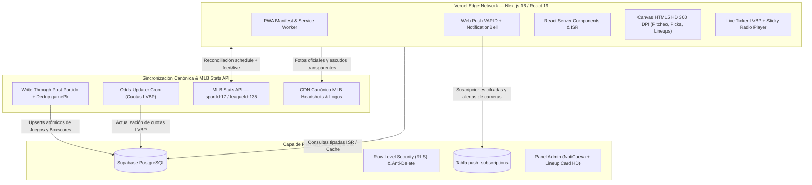

# REPUBLICARAQUISTAPP 🦁⚾

> **Plataforma Web y Progressive Web App (PWA) de Analítica Avanzada de Alto Rendimiento para la Liga Venezolana de Béisbol Profesional (LVBP), con enfoque en los Leones del Caracas.**

[](https://republicaraquistapp.vercel.app/)
[](https://nextjs.org/)
[](https://react.dev/)
[](https://tailwindcss.com/)
[](https://supabase.com/)
[](#-suites-de-vistas-y-módulos-en-vivo)
[](./LICENSE)
[](./LICENSE)

---

## 🦁 Acerca del Proyecto (About)

**República Caraquista** nació con una misión clara: **elevar la experiencia del fanático de los Leones del Caracas y de la LVBP a los estándares analíticos y tecnológicos del béisbol moderno de Grandes Ligas.**

Históricamente, el seguimiento de la pelota invernal venezolana ha dependido de portales lentos o limitados a estadísticas tradicionales de la era del papel (AVG, ERA, W-L). **República Caraquista** une tres pilares fundamentales:

1. **Pasión Caraquista Auténtica:** Diseñada desde la cueva para la fanaticada más exigente de Venezuela, con streaming persistente del circuito radial (*La Mega 107.3 FM*), crónicas exclusivas en *NotiCueva* por Gilberto Méndez y un Game Center en vivo pensado para vivir cada entrada.
2. **Analítica Avanzada de Grado Profesional:** Modelos y cálculos en tiempo real aplicados a la LVBP: matrices de expectativa de carreras (*Tango RE24 de 24 estados*), probabilidades de victoria (*Win Expectancy*), índices de apalancamiento (*Leverage Index*), *wOBA*, *wRC+*, *FIP*, *BABIP*, Factores de Parque empíricos por estadio y evento, dispersión de spray charts con evaluador *Would It Dong?*, optimizador de lineup Tom Tango y tarjetas visuales de pitcheo inspiradas en *Thomas Nestico (TJStats)*.
3. **Ingeniería de Software de Vanguardia:** Una Progressive Web App (PWA) instalable, ligera y ultrarrápida (Next.js 16 con Turbopack, React 19, Tailwind CSS v4 y Supabase), con sincronización canónica post-partido en tiempo real, notificaciones Web Push nativas y centro de alertas integrado.

---

## 🌟 Visión Arquitectónica

**REPUBLICARAQUISTAPP** implementa una arquitectura nativa de borde (Edge-first) con renderizado híbrido reactivo, sincronización canónica en tiempo real entre Supabase y MLB Stats API (normalizada a hora oficial venezolana VET / UTC-4), y telemetría de rendimiento con Vercel Web Analytics.



- **Frontend en Vercel:** Next.js 16.3.6 (Turbopack) con React 19, Tailwind CSS v4, tema Dark Navy (`#070B19`), Tarjetas Glassmorphism (`#0D152B`) y acentos Dorado Caraquista (`#FDB827`), más telemetría con `@vercel/analytics`.
- **Sincronización Canónica Post-Partido:** Reconciliación automática entre Supabase y MLB Stats API (`officialDate` VET UTC-4, deduplicación de `gamePk` en juegos reprogramados/dobles juegos y write-through atómico de boxscores).
- **PWA Instalable, Centro de Notificaciones & Web Push:** Suscripción VAPID desde navegador, campana de notificaciones (`NotificationBell`) con actividad en vivo y alertas automáticas de anotación (`broadcast-scoring`) y publicaciones de *NotiCueva*.
- **Audio Streaming en Vivo:** Reproductor flotante persistente de **La Mega 107.3 FM (Unión Radio)** para escuchar las transmisiones de los Leones del Caracas sin cortar la navegación.
- **CDN Canónico de Fotos:** Headshots oficiales servidos con cascada local optimizada (`/assets/players/{id}.png`), TuJonrón CDN y fallback oficial de MLB (`img.mlbstatic.com`).

---

## ⚾ Suites de Vistas y Módulos en Vivo

### 1. En Vivo, Cobertura, Temporada y Equipo

| Ruta | Módulo | Descripción y Capacidades |
| :--- | :--- | :--- |
| `/` | **Centro de Mando** | Scoreboard en vivo cara a cara, series particulares contra cada rival de la LVBP, desglose canónico Día (< 18:00 VET) y Noche (≥ 18:00 VET) y Semanas ISO. Suite de 5 pestañas: **Último Juego** (MVP del encuentro vía Tango RE24), **Tendencias** (últimos 10 juegos), **Rachas Activas** (hits/embasado bajo regla MLB 9.23b, brazos en blanco y rachas H2H), **Líderes del Equipo** (OPS y ERA) y **Leones Stats** (splits situacionales, récord por canal de TV y extrainnings). |
| `/game-center` | **Game Center (En Vivo)** | Segunda pantalla oficial de Leones del Caracas: diamante SVG con corredores, conteo LED, duelo en el plato en tiempo real, linescore R-H-E, play-by-play inverso, curva de **Win Probability en vivo**, **Hoja de Anotación (Scorecard Oficial)**, **Boxscore Oficial 1-9** (con preservación de `PR`/`PH` y envío directo del lineup del día al **Optimizador Tom Tango**), sintonía de TV y acceso al Circuito Radial. |
| `/noticueva` | **NotiCueva** | Espacio editorial con crónicas de la cueva por Gilberto Méndez y feed oficial integrado de X (`@RepubCaraquista`). |
| `/admin` | **Panel Admin (NotiCueva & Lineup HD)** | Panel protegido por autenticación para redactar/editar/publicar crónicas de *NotiCueva* y **Generador de Tarjeta Oficial de Lineup HD** (Canvas HTML5 con fuentes *Righteous* y *Jura*, consumo en vivo de MLB Stats API, broadcast TV, estadio, orden 1–9 con posiciones en español y envío Push 1-click). |
| `/standings` | **Posiciones** | Tabla de clasificación oficial de la LVBP con Expectativa Pitagórica ($xW/xL$, exponente `1.83`), pestaña y panel de **Power Rankings**, y **Simulador Monte Carlo** de clasificación (con columna `ELO` en la tabla de *Probabilidades de Clasificación por Franquicia*). |
| `/calendario` | **Calendario Oficial LVBP** | Cuadrícula mensual interactiva (Octubre, Noviembre, Diciembre) con diferenciación local/visitante, marcadores sincronizados en tiempo real, exportación `.ics` y suscripción en 1 clic a Google Calendar y Apple Calendar (`webcal://`), además de logos oficiales de televisoras y streaming. |
| `/roster` | **Roster Oficial & Coaching Staff** | Nómina semanal oficial de 34 jugadores activos clasificada por rol, fotos oficiales, datos biográficos, cuerpo técnico liderado por José Alguacil, filtros por posición y buscador. |
| `/bullpen` | **Bullpen, Carga & Lineups** | Efectividad de relevistas, corredores heredados ($IR$, $IRS$, $IRS\%$), presupuesto/carga de lanzamientos por relevista, **Optimizador de Lineup Tom Tango** y modo **Mejor Lineup Posible sobre Roster Activo** con restricciones defensivas de 9 posiciones y exclusión de peloteros. |
| `/probabilidades` | **Líneas & Probabilidades (Tipster Hub)** | Proyecciones por encuentro (FIP abridores + bullpen + factores de parque LVBP + Poisson/Skellam), Cuotas Justas, comparador de 4 casas de apuestas (**JuegaEnLínea**, **Betcris**, **SellaTuParley**, **Apuestas Royal**), detector de **Mejor Cuota** y valor ($EV \ge 12\%$), **Quarter-Kelly**, simulador libre de enfrentamientos y exportador Canvas HD dual (1:1 `2400x2400` y 9:16 `1080x1920`). |

### 2. Analítica Avanzada

| Ruta | Módulo | Descripción y Capacidades |
| :--- | :--- | :--- |
| `/individuales` | **Líderes Individuales** | 6 vistas integradas: **Bateo** y **Pitcheo** tradicionales y avanzados (`AVG`, `OBP`, `SLG`, `OPS`, `ISO`, `BABIP`, `ERA`, `WHIP`, `K/9`, `BB/9`, `K/BB`, `GIDP`), **Premios** (rastreador de candidatos a **MVP y Pitcher del Año** con `awards-engine`), **Splits** por jugador, **Fildeo** (`PO`, `A`, `E`, `TC`, `FPCT`, `DP`, `RF/9`, `CS`, `SB`, `CS%`, `PB`) y **Buscador por Rango de Fechas** (presets `7d`/`14d`/meses, calificación dinámica proporcional al rango y comparativa interanual opcional $\Delta$). |
| `/pitching` | **Pitching Summary & Telemetría** | Buscador universal de lanzadores (MLB/MiLB y Leones del Caracas) con conmutador Salida Individual vs. Temporada Completa, telemetría 3x4, splits LHB/RHB y exportación de tarjeta cuadrada HD (`2400x2400 px` a 300 DPI) estilo Thomas Nestico (`@TJStats`). |
| `/matchup` | **Matchup 360 (H2H)** | Comparador Head-to-Head con radar polar de 8 ejes, desglose por categorías (Ofensiva, Volumen, Corrido y Defensa), veredicto analítico y exportación en PNG. |
| `/colectivas` | **Estadísticas Colectivas** | Rendimiento comparativo de bateo, pitcheo y fildeo entre las 8 franquicias LVBP con fila de **Total Liga** y **Promedio por Juego** (`/JJ` y `9 Inn`), visibilidad de `GIDP`, gráficos horizontales y pestaña **Buscador** por rango de fechas con comparativa interanual ($\Delta$). |
| `/wpa` | **Win Expectancy & WPA** | Curvas interactivas de probabilidad de victoria por encuentro, matriz Tango RE24 de 24 estados, Leverage Index (LI), jugadas clave y acumulados de temporada. |
| `/situacional` | **Splits Situacionales & LOB** | Rendimiento con corredores en posición anotadora (RISP), bases llenas, splits por inning y lateralidad, matriz BvP y **Tracker de Dejados en Base (LOB)** (3er out y RISP LOB). |
| `/spray-charts` | **Spray Charts & Strike Zone** | Gráficos espaciales de batazos sobre diamante con modelo determinístico de dureza BIS (`Hard`, `Medium`, `Soft`), mapas de calor `3x3` de disciplina en el plato (`O-Swing%`, `Z-Contact%`, `SwStr%`, `CSW%`) y evaluador **"Would It Dong?"** (`HR en X/8` estadios de la LVBP). *Prohibición estricta de métricas Statcast en LVBP.* |
| `/park-factors` | **Factores de Parque** | Cálculo empírico por estadio real (`venue`, separando Estadio Universitario de Forum La Guaira / Macuto y Monumental) controlado iterativamente por fuerza de equipos por temporada (`2024–2026`), cubriendo **Carreras (`R`)**, **HR**, **H**, **2B**, **3B**, **BB** y **SO**, con conmutador **Estabilizado (`k=30`) / Crudo**, escala **Base 100 / 1.00x**, dimensiones de barda, altitud y gráfico comparativo Recharts. |

### 3. Módulos Globales y Páginas Legales

- **Live Ticker LVBP:** Barra superior en vivo con marcadores de la jornada, caché HTTP con kill-switch de versión (`v=2`) y control de visibilidad en segundo plano.
- **Circuito Radial en Vivo (Sticky Player):** Señal persistente de **La Mega 107.3 FM / Unión Radio**.
- **Notificaciones Push & Campana:** Alertas de inicio de juegos, carreras anotadas en vivo y crónicas de *NotiCueva*.
- **Orientación Responsiva & Mobile-First:** Adaptación Portrait/Landscape y barra inferior móvil (`BottomNav` + drawer lateral).
- **Legal (`/privacidad`, `/privacy`, `/terms`):** Política de privacidad y términos de uso de la plataforma.

---

## 📡 API Routes y Endpoints Serverless

La plataforma expone endpoints optimizados sobre Next.js App Router:

```text
src/app/api/
├── bullpen/                  # Efectividad, IR/IRS, presupuesto de pitcheo y lineups/optimizador
├── calendar/                 # Calendario oficial LVBP y feed webcal (.ics)
├── game-center/              # Live feed agregado, Scorecard, Win Probability y boxscore oficial
├── games/                    # Listado de partidos, marcadores y resúmenes recientes
├── kpis/                     # Indicadores de alto nivel para el Centro de Mando
├── noticueva/
│   ├── route.ts              # Listado y creación de publicaciones editoriales
│   ├── auth/                 # Autenticación del panel administrativo
│   ├── lineup-card/          # Datos de juego/lineup en vivo para generador de tarjeta HD
│   ├── status/               # Estado del servicio editorial
│   ├── tweets/               # Timeline embebido de X (@RepubCaraquista)
│   └── [id]/                 # Consulta, edición y publicación por ID
├── notifications/            # Feed del centro de notificaciones en vivo
├── odds/                     # Cuotas de casas de apuestas, cuotas justas y valor (+EV)
├── park-factors/             # Factores de parque empíricos por ventana (multi/2026/2025/2024)
├── pitching/
│   ├── game-data/            # Telemetría detallada de lanzadores por salida
│   ├── game-logs/            # Historial de salidas PBP / MLB
│   ├── search/               # Buscador universal de lanzadores
│   └── season-data/          # Métricas acumuladas por temporada
├── push/
│   ├── broadcast-scoring/    # Emisión automática de alertas Push ante anotaciones en vivo
│   ├── public-key/           # Llave pública VAPID
│   ├── send/                 # Envío protegido de notificaciones Push
│   ├── status/               # Verificación de soporte Push
│   └── subscribe/            # Registro de suscripciones Push en Supabase
├── situacional/              # Splits RISP, bases llenas, platoon y LOB Tracker
├── spray/                    # Coordenadas de spray chart, disciplina 3x3 y Would It Dong
├── standings/                # Tabla de posiciones, Power Rankings y simulación Monte Carlo
├── stats/
│   ├── batting/              # Bateo individual (soporta startDate/endDate y premios)
│   ├── collective/           # Colectivas de los 8 equipos (soporta rango de fechas)
│   ├── fielding/             # Fildeo individual por posición (soporta rango de fechas)
│   ├── pitching/             # Pitcheo individual (soporta startDate/endDate y premios)
│   └── player-splits/        # Splits avanzados por jugador
├── ticker/                   # Ticker en vivo de la jornada LVBP
└── wpa/                      # Curvas de Win Expectancy y matrices Tango RE24
```

---

## 🛠️ Stack Tecnológico

| Capa | Tecnología | Versión | Propósito |
| :--- | :--- | :--- | :--- |
| **Framework Web** | Next.js (App Router, Turbopack) | `16.3.6` | Renderizado híbrido SSR/ISR/Edge |
| **Librería UI** | React / React DOM | `19.2.8` | Componentes concurrentes y hooks modernos |
| **Lenguaje** | TypeScript | `5.x` | Tipado estricto en toda la aplicación |
| **Estilos e Iconos** | Tailwind CSS v4, Lucide React | `^4.0.0` / `^1.48.0` | Sistema Dark Navy `#070B19` y Dorado `#FDB827` |
| **Visualización** | Recharts, SVG nativo, Canvas HTML5 | `^3.10.1` | Gráficos interactivos y exportación HD a 300 DPI |
| **Base de Datos** | Supabase PostgreSQL con RLS | `@supabase/supabase-js ^2.117.1` | Persistencia relacional, RLS y roles |
| **Notificaciones** | Web Push / Service Worker | `web-push ^3.6.7` | Notificaciones push con cifrado VAPID |
| **Analítica Web** | Vercel Analytics | `@vercel/analytics ^2.0.1` | Métricas de tráfico y rendimiento en producción |
| **Despliegue** | Vercel Edge Network | Edge / Node | Hosting continuo con CI/CD automatizado |

---

## 🔒 Seguridad y Row Level Security (RLS)

La base de datos en Supabase opera bajo estrictas políticas de **Row Level Security**:
- **Lectura Pública:** Consultas anónimas autorizadas para tablas de estadísticas (`teams`, `games`, `players`, `batting_stats`, `pitching_stats`, `noticueva_posts`).
- **Protección contra Borrado:** Las llamadas anónimas tienen **prohibido el borrado (`DELETE`)** en todas las tablas de datos deportivos.
- **Ingesta Segura:** Uso separado de `SUPABASE_SERVICE_ROLE_KEY` en servidor para write-through autorizado, nunca expuesto al cliente.
- **Notificaciones y Admin:** Llaves VAPID y secreto de panel `/admin` gestionados exclusivamente mediante variables de entorno de servidor.

---

## 📦 Instalación, Pruebas y Desarrollo Local

### 1. Clonar e instalar dependencias
```bash
git clone git@github.com:jloreto9/republicaraquista-web.git
cd republicaraquista-web
npm install
```

### 2. Configurar variables de entorno
Copia `.env.example` a `.env.local` y completa tus claves:
```ini
NEXT_PUBLIC_SUPABASE_URL=https://tu-proyecto.supabase.co
NEXT_PUBLIC_SUPABASE_ANON_KEY=tu-anon-key-de-supabase
SUPABASE_URL=https://tu-proyecto.supabase.co
SUPABASE_KEY=tu-anon-key-de-supabase
SUPABASE_SERVICE_ROLE_KEY=tu-service-role-key
NOTICUEVA_ADMIN_PASSWORD=tu-contraseña-segura

# Web Push Notifications (VAPID)
NEXT_PUBLIC_VAPID_PUBLIC_KEY=tu-clave-publica-vapid
VAPID_PRIVATE_KEY=tu-clave-privada-vapid
VAPID_SUBJECT=mailto:contacto@republicaraquista.com
```

### 3. Desarrollo local
```bash
npm run dev
```
Abre [http://localhost:3000](http://localhost:3000) en tu navegador.

### 4. Pruebas, Linter y Compilación
Las pruebas unitarias del repositorio usan `node:assert/strict` (ejecutadas con `tsx` para TypeScript y `node` para módulos `.mjs`):

```bash
# Ejecutar todas las pruebas TypeScript en src/lib/__tests__/
npx tsx src/lib/__tests__/awards-engine.test.ts
npx tsx src/lib/__tests__/fielding-stats.test.ts
npx tsx src/lib/__tests__/individual-date-range.test.ts
npx tsx src/lib/__tests__/park-factors.test.ts
# ... (y el resto de archivos *.test.ts en src/lib/__tests__/)

# Ejecutar pruebas .mjs en test/
node test/best-available-lineup.test.mjs
node test/bullpen-ir-irs.test.mjs
node test/calendar-today.test.mjs
node test/gamecenter-lineup-optimizer.test.mjs

# Linter y Build de producción
npm run lint
npm run build
```

---

## 📋 Especificaciones (`specs/`)

El desarrollo de funcionalidades nuevas y correcciones sigue la metodología **Spec-Driven Development** bajo [`specs/`](./specs/) (`001` a `032`), manteniendo trazabilidad completa (`spec.md`, `plan.md`, `tasks.md`, `implementation.md`).

---

## 🚢 Despliegue en Producción (Vercel)

El proyecto está configurado con integración continua en Vercel:
1. Cada `push` a la rama `main` dispara automáticamente la compilación optimizada con Turbopack.
2. Despliegue activo en: **[https://republicaraquistapp.vercel.app/](https://republicaraquistapp.vercel.app/)**

---

## ⚖️ Créditos y Reconocimientos

- **Diseño, Desarrollo y Analítica:** **Jorge Leonardo Loreto** ([@JorgeLoreto](https://x.com/JorgeLoreto)) • [@RepubCaraquista](https://x.com/RepubCaraquista)
- **Crónicas de NotiCueva:** **Gilberto Méndez** ([@GilbertoMendez](https://x.com/GilbertoMendez))
- **Diseño de Tarjetas de Pitcheo:** Inspirado en Thomas Nestico ([@TJStats](https://x.com/TJStats))
- **Datos Oficiales de Béisbol:** Consumidos en tiempo real desde MLB Stats API (`sportId=17`, `leagueId=135`)
- **Transmisión Radial:** **La Mega 107.3 FM / Unión Radio**, Circuito Oficial de los Leones del Caracas

---

## 📄 Licencia

Este proyecto opera bajo un esquema de **licencia dual**:
- **Código Fuente del Software:** Licenciado bajo la **[Licencia MIT](./LICENSE)**. Libre para estudiar, clonar, bifurcar y usar con fines de portafolio y aprendizaje.
- **Contenido Editorial, Crónicas y Marca:** Licenciado bajo **[Creative Commons Atribución-NoComercial 4.0 Internacional (CC BY-NC 4.0)](./LICENSE)**. Protege las notas de *NotiCueva*, crónicas y la identidad visual de explotación comercial sin consentimiento previo.
