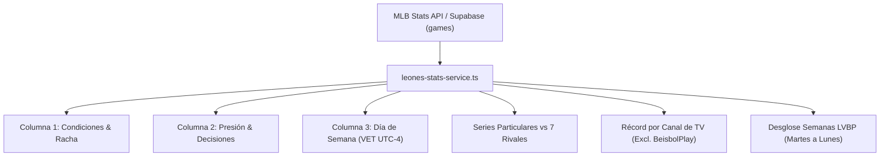

# 🦁 Manual Canónico de Reglas: Suite Leones Stats

> **Manual Oficial de Reglas de Negocio, Criterios Sabermétricos y Fórmulas**  
> **Repositorio**: `jloreto9/republicaraquista-web` (REPUBLICARAQUISTAPP)  
> **Autor**: Jorge Leonardo Loreto • Data Scientist en Control Financiero & Baseball Analytics  
> **Stack**: Next.js 16 • React 19 • Supabase (PostgreSQL) • MLB Stats API  
> **Fuentes de Verdad**:
> - [`src/types/leones-stats.ts`](../src/types/leones-stats.ts)
> - [`src/lib/leones-stats-service.ts`](../src/lib/leones-stats-service.ts)
> - [`src/components/dashboard/tabs/leones-stats-tab.tsx`](../src/components/dashboard/tabs/leones-stats-tab.tsx)
> - [`src/lib/constants.ts`](../src/lib/constants.ts)

---

## 1. Visión General de la Interfaz

El panel **"Estadísticas de Situación"** en la pestaña **🦁 Leones Stats** del Centro de Mando es el tablero analítico estratégico de Leones del Caracas en la Liga Venezolana de Béisbol Profesional (LVBP).

Su propósito es descomponer el balance de victorias y derrotas bajo diferentes contextos competitivos, climáticos, de presión, de decisiones de pitcheo y de alineación.

---

## 2. Columna 1: Condiciones Generales, Racha y Presencia

Monitorea el balance global del equipo, factores de sede, horario y la métrica de impacto de alineación **Sin Rondón**.

| Métrica | Clave TypeScript | Definición y Regla Canónica | Valores / Formato |
|---|---|---|---|
| **Juego Nº y Récord** | `totalGames`, `record` | Total de encuentros oficiales de temporada regular finalizados (`status` in `Final`, `Completed`, etc.) y balance global victorias-derrotas. | `Juego Nº22 (12-10)` |
| **Home Club** | `homeRecord` | Récord en condición de local en el Estadio Monumental Simón Bolívar (`home_team_id === 695`). | `G-P` (ej. `6-5`) |
| **Visitante** | `awayRecord` | Récord en la carretera / condición de visitante (`away_team_id === 695`). | `G-P` (ej. `6-5`) |
| **De Noche** | `nightRecord` | Encuentros cuya hora de inicio en hora legal de Venezuela (VET / UTC-4) es **$\ge$ 18:00 (6:00 PM)**. Si no hay hora explícita en calendario, la LVBP asigna horario nocturno por defecto. | `G-P` (ej. `7-8`) |
| **De Día** | `dayRecord` | Encuentros iniciados antes de las 18:00 VET (**< 6:00 PM**) o con bandera explícita `is_day_game === true`. | `G-P` (ej. `5-2`) |
| **Blanqueo** | `shutouts` | Victorias del club donde el rival finalizó con 0 carreras anotadas (`won === true && oppScore === 0`). | Entero $\ge 0$ (ej. `0`) |
| **Racha** | `streak` | Seguidilla activa de victorias (`W`) o derrotas (`L`) consecutivas ordenada cronológicamente por la fecha venezolana del encuentro. | `X W` o `X L` (ej. `5 W`) |
| **En Extrainning** | `extraInning` | Récord en juegos decididos más allá de las entradas reglamentarias pactadas (`scheduledInnings`). Compara entradas jugadas contra pactadas (9 en juego sencillo, 7 en dobles carteleras de la LVBP). | `G-P` (ej. `1-0`) |
| **Ult-10J** | `last10` | Balance de victorias y derrotas en la ventana de los últimos hasta 10 partidos completados cronológicamente (`slice(-10)`). | `G-P` (ej. `7-3`) |
| **Con Rondón** | `withRondon` | Balance de victorias y derrotas de Leones del Caracas en aquellos encuentros oficiales donde **José Rondón** (MLB ID `602922`, `JOSE_RONDON_ID`) **sí vio acción activa en el terreno** ($PA = AB + BB + HBP + SF + SH + R + SB > 0$). | `G-P` (ej. `6-8` en 2026, `12-24` en 2025) |
| **Sin Rondón** | `withoutRondon` | Balance de victorias y derrotas de Leones del Caracas en aquellos encuentros oficiales donde **José Rondón** **no vio acción oficial** ($PA = 0$ o ausencia de registro en `batting_stats`). | `G-P` (ej. `6-2` en 2026, `12-8` en 2025) |

> [!NOTE]
> **Origen y Contexto Sabermétrico del Dúo "Con Rondón / Sin Rondón"**:  
> - **Temporada 2024-2025 (2025)**: José Rondón estuvo ausente en 20 encuentros. En ese tramo sin él, Leones tuvo récord ganador de **12-8 (.600)**, mientras que con él en acción registró **12-24 (.333)**.
> - **Temporada 2026-2027 (2026 en curso)**: Tras sufrir una lesión a inicios de noviembre y descansar en 8 juegos en total, Leones marcha con récord de **6-2 (.750)** sin él (incluyendo la racha activa de 5 victorias de noviembre), frente a **6-8 (.429)** con él en alineación.  
> La comparativa cara a cara entre ambos registros se consolidó como una de las conversaciones analíticas más populares, reveladoras y divertidas en la afición caraquista.

---

## 3. Columna 2: Situaciones de Presión & Decisiones de Pitcheo

Refleja la resiliencia en situaciones apretadas, la capacidad de remontar o proteger ventajas, y la efectividad del cuerpo de lanzadores.

| Métrica | Clave TypeScript | Definición y Regla Canónica | Valores / Formato |
|---|---|---|---|
| **Por 1 Carrera** | `oneRun` | Balance en encuentros con margen final de exactamente una carrera ($\|CF - CP\| = 1$). | `G-P` (ej. `1-3`) |
| **Remontados** | `remontados` | Partidos donde Leones iba perdiendo en el marcador al completarse el **6to inning** ($\sum_{i=1}^6 R_{\text{CAR}} < \sum_{i=1}^6 R_{\text{Rival}}$) y terminó ganando el juego. | Entero $\ge 0$ (ej. `2`) |
| **Arriba** | `up` | Récord de Leones cuando llegaba con ventaja en el marcador al completarse el **6to inning** ($\sum_{i=1}^6 R_{\text{CAR}} > \sum_{i=1}^6 R_{\text{Rival}}$). | `G-P` (ej. `9-1`) |
| **Terreneadas** | `terreneadas` | Victorias dejando al rival en el terreno (*Walk-off wins*): Leones como local (`home`), victoria (`won = true`) decretada en la parte baja de la última entrada reglamentaria o extrainning (`half === 'bottom' && inning >= scheduled`), o bandera `isWalkOff` en la jugada final de MLB Stats API. | Entero $\ge 0$ (ej. `0`) |
| **Pechofriadas** | `pechofriadas` | Partidos perdidos tras haber tenido una ventaja de **5 o más carreras** ($\ge 5$) en cualquier momento del encuentro, evaluado jugada a jugada (`allPlays`) y entrada por entrada acumulada (`linescore.innings`). | Entero $\ge 0$ (ej. `3`) |
| **Abridores** | `starters` | Decisiones oficiales (W-L) acreditadas al lanzador abridor (primer lanzador del boxscore de Leones). | `G-P` (ej. `4-6`) |
| **Relevistas** | `relievers` | Decisiones oficiales (W-L) acreditadas al cuerpo de relevistas de Leones (`pitchers.slice(1)`). | `G-P` (ej. `8-4`) |
| **Salvados** | `saves` | Total de juegos finalizados con juego salvado (SV) acreditado oficialmente a un relevista de Leones. | Entero $\ge 0$ (ej. `4`) |
| **OCT / NOV / DEC** | `oct`, `nov`, `dec` | Balance mensual victorias-derrotas según la fecha venezolana del juego (`month === 10`, `11`, `12`). | `XG-YP` (ej. `7G-8P`, `5G-2P`) |

> [!IMPORTANT]
> **Invariante de Pechofriada**:  
> No importa el inning ni si la ventaja se perdió en el 4to, 8vo o extrainning. Basta con que en algún punto del partido Leones haya estado arriba por $\ge 5$ carreras (ej. 5-0, 8-3, 10-5) y el juego haya terminado en derrota.

---

## 4. Columna 3: Por Día de Semana

Desglose de rendimiento diario con normalización obligatoria a la zona horaria venezolana (VET / UTC-4):

$$\text{Día de la Semana} = \text{FechaVET}(\text{game\_datetime}) \pmod 7$$

| Día | Formato | Criterio de Asignación Temporal |
|---|---|---|
| **Lunes** | `0G-1P` | Juegos de reposición o jornadas especiales de inicio de semana. |
| **Martes** | `0G-3P` | Apertura de semana oficial de campeonato LVBP. |
| **Miércoles** | `3G-0P` | Jornada intersemanal. |
| **Jueves** | `0G-2P` | Jornada intersemanal / Clásicos. |
| **Viernes** | `3G-2P` | Inicio de jornadas de fin de semana. |
| **Sábado** | `3G-1P` | Jornadas vespertinas o dobles juegos de sábado. |
| **Domingo** | `3G-1P` | Jornadas diurnas de cierre de semana LVBP. |

> [!WARNING]
> **Blindaje contra el desfase de medianoche UTC**:  
> Todo cómputo utiliza la utilidad canónica `getVenezuelanDate(dateStr, datetimeStr)`. Un juego que comienza en Caracas el sábado a las 8:00 PM VET (00:00 UTC del domingo) se asigna estrictamente al **Sábado**.

---

## 5. Sub-Panel: Series Particulares (Récord vs Rivales)

Monitorea el cara a cara frente a los otros 7 equipos de la LVBP:

- **Estructura**: 8 juegos programados contra cada rival en temporada regular oficial ($7 \times 8 = 56$ encuentros).
- **Rivales Oficiales**:
  - `696`: Navegantes del Magallanes (`MAG`)
  - `698`: Tiburones de La Guaira (`LAG`)
  - `693`: Cardenales de Lara (`LAR`)
  - `692`: Águilas del Zulia (`ZUL`)
  - `699`: Tigres de Aragua (`ARA`)
  - `697`: Bravos de Margarita (`MAR`)
  - `694`: Caribes de Anzoátegui (`ORI`)
- **Métricas Registradas por Rival**:
  1. `gamesPlayed` y `remainingGames` ($8 - \text{jugados}$).
  2. `record` (`W-L`) y Porcentaje de Victorias (`pct`, ej. `.625`).
  3. `runsFor` (Carreras a favor) y `runsAgainst` (Carreras en contra).
  4. `runDiff` (Diferencial con signo explícito: `+X` o `-X`).
  5. `homeRecord` / `awayRecord` (Desglose en el Monumental vs estadio rival).
  6. `statusText`: Estado de la serie:
     - `Leones lidera X-Y` (si $W > L$)
     - `[Rival] lidera Y-X` (si $L > W$)
     - `Empatada X-Y` (si $W = L$ con juegos disputados)
     - `Sin disputar` (si no se ha disputado ningún encuentro)

---

## 6. Sub-Panel: Récord por Canal de Transmisión (TV & Streaming)

Evalúa el récord de Leones del Caracas según el canal lineal que transmite el partido:

- **Canales Monitoreados**:
  - **ByM Sport**
  - **1Baseball Network**
  - **IVC**
  - **Televen**
  - **Venevisión**
  - **Meridiano TV**
  - **LVBP YouTube**
  - **SimpleTV**
- **Regla de Exclusión de BeisbolPlay**:
  - BeisbolPlay transmite el **100% de los 56 encuentros** de la temporada vía streaming. Por ende, no entra en la comparativa de canales lineales individuales y se muestra con un badge informativo especial.

---

## 7. Tabla Inferior: Desglose Semana a Semana LVBP

En la LVBP, el calendario oficial de campeonato no utiliza semanas gregorianas (lunes a domingo), sino ciclos de **Martes a Lunes**:

$$\text{Semana LVBP} = [\text{Martes}_k, \text{Lunes}_{k+1}]$$

- **11 Semanas de Serie Regular**:
  - `Semana`: Nombre y rango (ej. `Semana 1 (12/10 - 19/10)`).
  - `Juegos`: Encuentros disputados.
  - `G` / `P`: Victorias y Derrotas.
  - `PCT`: Porcentaje de victorias en 3 decimales (`.500`).
  - `CF` / `CP`: Carreras anotadas y recibidas en esa semana.
  - `DIF`: Diferencial neto (`+X` / `-X`).
  - `Récord`: Formato resumen `XG-YP`.

---

## 8. Líneas Base y Aislamiento por Temporada

1. **Temporada Histórica 2025-2026**:
   - Mantiene la línea base auditada `BASELINE_2025_STATS` (56 juegos: 24-32, Sin Rondón: 12-8, etc.) como fuente inmutable.
2. **Temporada Activa 2026-2027**:
   - Se calcula dinámicamente consultando Supabase (`games`, `batting_stats`, `pitching_stats`) y procesando los feeds en vivo de MLB Stats API.
