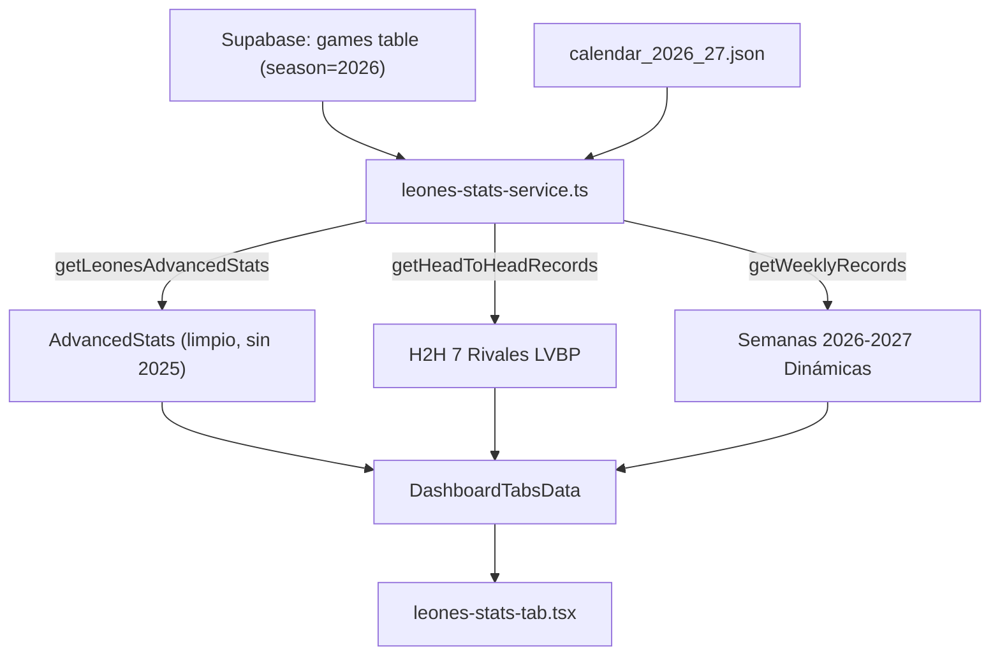

# Technical Plan: Series Particulares & Fix de Estadísticas Situacionales en Leones Stats

> **Feature**: `002-leones-stats-series-particulares`  
> **App**: `republicaraquista-web` (REPUBLICARAQUISTAPP)  
> **Status**: In Design  

---

## 1. Archivos Afectados

1. **`src/types/leones-stats.ts`**:
   - Agregar tipo `HeadToHeadRecord` (interfaz con rivalId, rivalName, rivalAbbr, rivalLogo, scheduledGames, gamesPlayed, wins, losses, record, pct, runsFor, runsAgainst, runDiff, homeRecord, awayRecord, statusText).
   - Añadir `h2hRecords: HeadToHeadRecord[]` en `DashboardTabsData`.

2. **`src/lib/leones-stats-service.ts`**:
   - Corregir `getLeonesAdvancedStats(season)` para que `season !== 2025` calcule dinámicamente y use inicialización limpia en 0 para contadores de presión y decisiones de pitcheo (sin caer en `BASELINE_2025_STATS`).
   - Implementar `getHeadToHeadRecords(season)` calculando récord contra cada uno de los 7 rivales a partir de `calendar_2026_27.json` y los partidos jugados en Supabase.
   - Corregir `getWeeklyRecords(season)` para construir la progresión de semanas 2026-2027 dinámicamente con base en las semanas del campeonato y los partidos finalizados en Supabase.
   - Actualizar `getDashboardTabsData(season)` para incluir `h2hRecords`.

3. **`src/components/dashboard/tabs/leones-stats-tab.tsx`**:
   - Agregar prop `h2hRecords: HeadToHeadRecord[]`.
   - Renderizar la tarjeta interactiva de **Series Particulares (Récord vs. Rivales)** ubicada inmediatamente debajo de la cuadrícula de Estadísticas de Situación.
   - Grid responsivo (2 a 4 columnas) con logo del rival, badge de estado, récord G-P, PCT, diferencial de carreras y juegos restantes.

4. **`src/components/dashboard/dashboard-tabs.tsx`**:
   - Pasar `h2hRecords={data.h2hRecords}` a `<LeonesStatsTab />`.

---

## 2. Diagrama de Flujo de Datos

---

## 3. Criterios de Verificación y Pruebas

- Verificación manual y automatizada de los cálculos con Node.js.
- Verificación del renderizado en React y build de producción con `npm run build`.
