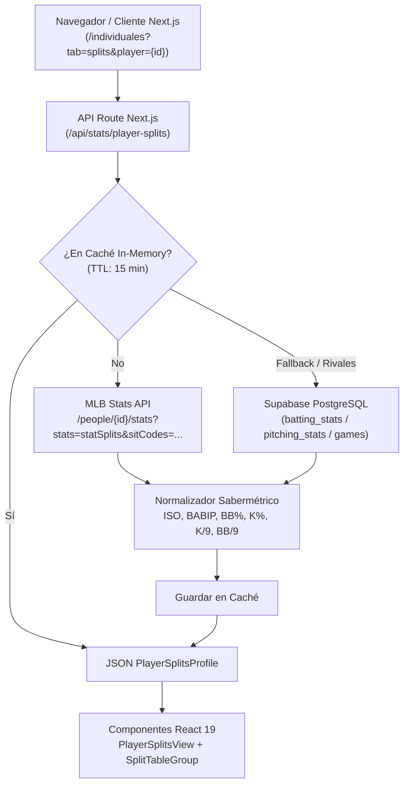

# Plan Técnico: Splits Completos Estilo FanGraphs (Bateadores y Lanzadores)

**Slug:** `010-splits-fangraphs-players`  
**Fase:** Planificación Técnica  
**Fecha:** 2026-10-21  

---

## 1. Arquitectura Técnica y Flujo de Datos

---

## 2. Archivos Afectados

1. **`src/types/player-splits.ts`**:
   - Extender interfaces `PlayerSplitRow` y `PitcherSplitRow` con métricas FanGraphs: `iso`, `babip`, `bbPct`, `kPct`, `kPerBb`, `hrPer9`.
   - Agregar categorías `count` (Conteos) y `role` (Rol Abridor/Relevista) en `SplitCategory`.
   - Agregar colecciones `countSplits?: PlayerSplitRow[]` y `roleSplits?: PitcherSplitRow[]` a `PlayerSplitsProfile`.

2. **`src/lib/player-splits-service.ts`**:
   - Integrar llamada directa a `https://statsapi.mlb.com/api/v1/people/{playerId}/stats?stats=statSplits&sitCodes=...` con catálogo de 25+ `sitCodes` oficiales.
   - Computar métricas sabermétricas FanGraphs ($ISO$, $BABIP$, $BB\%$, $K\%$, $K/BB$, etc.).
   - Mapear respuestas en las 7 categorías de splits: Platoon, Bases/RISP, Conteos, Entradas, Localía/Horario, Rol y Rivales.
   - Preservar cálculo de splits por rival a partir de Supabase.
   - Implementar caché en memoria con TTL de 15 minutos para optimizar tiempo de respuesta (< 80ms tras primer golpe).

3. **`src/components/stats/splits/split-table-group.tsx`**:
   - Actualizar cabeceras de tabla para exhibir columnas FanGraphs completas:
     - Bateadores: PA, AB, R, H, 2B, 3B, HR, RBI, BB, SO, AVG, OBP, SLG, OPS, ISO, BABIP, BB%, K%.
     - Lanzadores: IP, BF, H, R, ER, BB, SO, HR, ERA, WHIP, BAA, OBP, SLG, OPS, K/9, BB/9, K/BB, K%, BB%, BABIP.
   - Soporte de ordenamiento interactivo para las nuevas métricas.

4. **`src/components/stats/splits/player-splits-view.tsx`**:
   - Barra de filtros de categoría: `[Todos]`, `[Platoon]`, `[Bases & RISP]`, `[Conteos]`, `[Entradas & Outs]`, `[Localía & Horario]`, `[Rivales]`.
   - Renderizado condicional según categoría seleccionada.
   - Acceso universal a todos los jugadores de la LVBP con badge destacado para Leones del Caracas.

---

## 3. Plan de Rollback y Mitigación de Riesgos

- Si MLB Stats API presenta lentitud o timeout en un jugador, el servicio aplica fallback inmediato a los splits agregados de Supabase sin romper la página.
- Timeout estricto de 3500ms en el fetch a MLB Stats API mediante `AbortSignal.timeout(3500)`.
- Compatibilidad hacia atrás total con la interfaz `PlayerSplitsProfile`.
