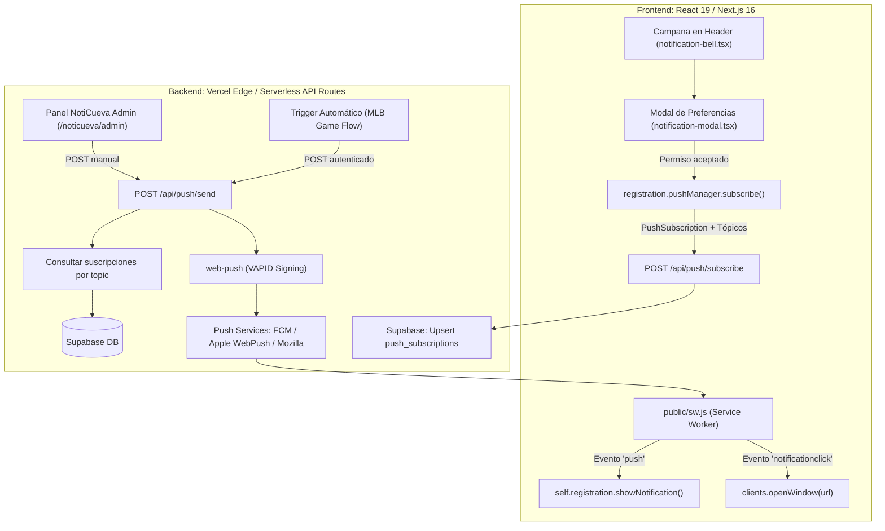

# Plan Técnico: Notificaciones Web Push PWA (República Caraquista)

**Slug:** `011-web-push-notifications`  
**Fase:** Planificación Técnica (Fase 2 de Spec-Kit)  
**Fecha:** 2026-10-21  

---

## 1. Arquitectura Técnica y Flujo de Componentes



---

## 2. Escalera Ponytail (Minimalismo & Cero Bloat)

1. **¿Se necesita construir? (YAGNI):** Sí, es la vía directa para retener fanáticos durante la temporada LVBP sin depender de algoritmos de redes sociales.
2. **¿Existe ya en el código?:** Sí, la base de la PWA (`sw.js`, `manifest.ts`, `pwa-register.tsx`) ya está operativa en producción.
3. **¿Librería de terceros SaaS vs Estándar?:**
   - **Rechazado:** OneSignal, Firebase Cloud Messaging SDK pesado, Pusher. Añaden scripts externos de rastreo, cuotas pagas y peso excesivo al bundle.
   - **Adoptado:** Estándar nativo **W3C Web Push API** en el cliente + librería minimalista `web-push` en serverless de Vercel (RFC 8291 / RFC 8292).
4. **Almacenamiento:** Directo en la base de datos existente **Supabase PostgreSQL** mediante RLS y upsert determinístico.

---

## 3. Esquema de Base de Datos (Supabase)

```sql
-- Tabla de Suscripciones Web Push
CREATE TABLE IF NOT EXISTS public.push_subscriptions (
    id UUID PRIMARY KEY DEFAULT gen_random_uuid(),
    endpoint TEXT UNIQUE NOT NULL,
    p256dh TEXT NOT NULL,
    auth TEXT NOT NULL,
    user_agent TEXT,
    topics TEXT[] NOT NULL DEFAULT ARRAY['game_status', 'news_roster'],
    created_at TIMESTAMPTZ NOT NULL DEFAULT NOW(),
    updated_at TIMESTAMPTZ NOT NULL DEFAULT NOW()
);

-- Índices de consulta rápida por tópicos
CREATE INDEX IF NOT EXISTS idx_push_subs_topics ON public.push_subscriptions USING GIN(topics);

-- RLS: Seguridad Serverless (Vercel Service Role gestiona lecturas/escrituras)
ALTER TABLE public.push_subscriptions ENABLE ROW LEVEL SECURITY;

CREATE POLICY "Service Role tiene acceso total"
    ON public.push_subscriptions
    FOR ALL
    USING (auth.role() = 'service_role');
```

---

## 4. Archivos Afectados

1. **`package.json`**:
   - Añadir dependencia backend: `web-push` y su devDependency `@types/web-push`.
2. **`public/sw.js`**:
   - Incorporar event listeners `push` y `notificationclick` con soporte de datos estructurados, iconos oficiales del equipo y manejo de foco de ventanas abiertas.
3. **`src/types/push-notifications.ts`**:
   - Definición de tipos TypeScript: `NotificationTopic`, `PushSubscriptionRecord`, `PushPayload`, `PushSendResult`.
4. **`src/lib/push-service.ts`**:
   - Configuración de VAPID con `webpush.setVapidDetails()`.
   - Lógica de despacho por lotes (`Promise.allSettled`).
   - Limpieza automática de suscripciones caducadas (eliminación en Supabase cuando el código es 404 o 410).
5. **`src/app/api/push/public-key/route.ts`**:
   - Endpoint GET liviano que expone la clave pública VAPID sin exponer secretos.
6. **`src/app/api/push/subscribe/route.ts`**:
   - Endpoint POST para registrar o actualizar suscripción y tópicos en Supabase.
7. **`src/app/api/push/send/route.ts`**:
   - Endpoint POST protegido con clave de administración / Bearer Token para despachar alertas.
8. **`src/components/notifications/notification-bell.tsx`**:
   - Botón interactivo de campana en el header global con indicador visual de estado.
9. **`src/components/notifications/notification-modal.tsx`**:
   - Modal accesible con los 4 toggles de tópicos, detección de iOS PWA (guía de instalación) y botón de prueba.
10. **`src/components/admin/push-broadcast-panel.tsx`**:
    - Panel de despacho manual en NotiCueva para enviar notificaciones personalizadas con vista previa en vivo.

---

## 5. Mitigación de Riesgos y Rollback

- **Fallo en servicio push de Apple o Google:** El despachador usa `Promise.allSettled`, garantizando que el fallo en un dispositivo individual no aborte el envío al resto de la base de suscriptores.
- **Revocación de permisos:** El cliente sincroniza su estado local al cargar la app; si el usuario revocó permisos en los ajustes del navegador, la UI se actualiza inmediatamente a modo apagado.
- **Rollback:** Si la feature requiere desactivarse, basta con apagar el flag de visualización de la campana en el header (`SHOW_NOTIFICATIONS = false`), sin alterar la base de datos ni romper la PWA.
