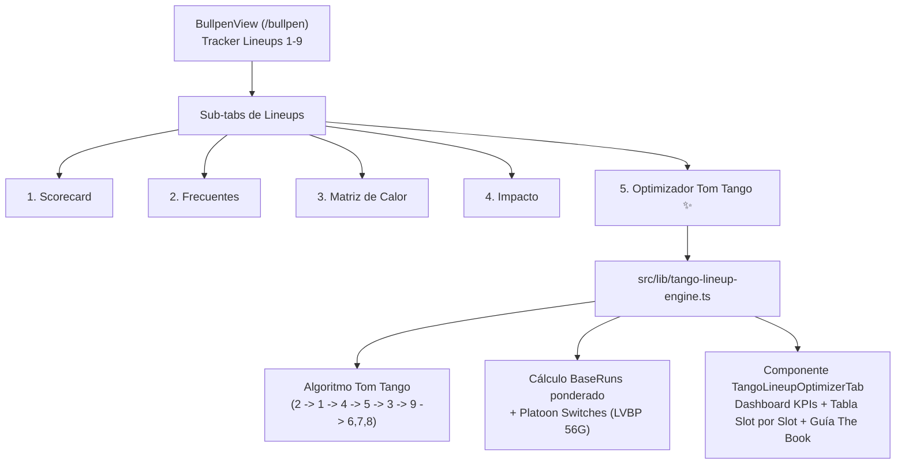

# Plan Técnico: Optimizador de Lineup Sabermétrico (Tom Tango)

**Slug:** `013-tango-lineup-optimizer`  
**Fase:** Planificación de Arquitectura Técnica (Fase 2 de Spec-Kit)  
**Fecha:** 2026-10-25  

---

## 1. Arquitectura de la Solución

El Optimizador de Lineups se implementará como un módulo de análisis y visualización integrado en la ruta `/bullpen`, operando con renderizado reactivo del lado del cliente (Client Component) y respaldado por estadísticas reales de bateadores de Leones del Caracas e historial de juegos empaquetados en los snapshots de temporada (`src/data/lvbp_season_*.json`).

---

## 2. Archivos Afectados y Creados

| Archivo | Rol | Operación |
|---|---|---|
| `src/types/tango-lineup.ts` | Definición de tipos canónicos de jugadores, slots y métricas Tango | Crear nuevo |
| `src/lib/tango-lineup-engine.ts` | Motor de cálculo sabermétrico, asignación y proyecciones de carreras | Crear nuevo |
| `src/components/bullpen/tango-lineup-optimizer-tab.tsx` | Componente de UI interactivo con selector, KPIs y comparativa | Crear nuevo |
| `src/components/bullpen/bullpen-view.tsx` | Integración del nuevo subtab en la barra de navegación del tracker | Modificar |
| `specs/013-tango-lineup-optimizer/tasks.md` | Desglose atómico de tareas | Crear nuevo |
| `specs/013-tango-lineup-optimizer/implementation.md` | Informe de ejecución y validación de aceptación | Crear nuevo |

---

## 3. Escalera Ponytail (Criterio de Simplicidad)

1. **YAGNI:** No crear microservicios ni APIs pesadas en Python para este cálculo: la lógica de Tom Tango es determinística y se ejecuta en microsegundos directamente en TypeScript en el navegador del cliente.
2. **Reutilización:** Reutilizar la tipografía, tarjetas y paleta cromática Glassmorphism de República Caraquista (`#070B19`, `#0D152B`, `#1E2B4D`, `#FDB827`).
3. **Fuente de Datos:** Reutilizar los `gameLineups` ya provistos en el hook del tracker (`data.lineups.gameLineups`), permitiendo al usuario seleccionar cualquier juego real de la temporada para optimizar la alineación exacta de ese día.

---

## 4. Plan de Rollback

Si surge alguna incompatibilidad:
1. Revertir `src/components/bullpen/bullpen-view.tsx` a su estado anterior (`git checkout src/components/bullpen/bullpen-view.tsx`).
2. La funcionalidad de las 4 pestañas previas del Bullpen y Lineups permanece 100% aislada e intacta.
