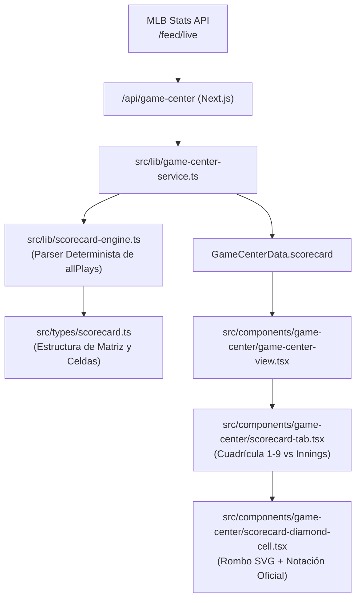

# Plan Técnico: Hoja de Anotación Oficial en Vivo (Baseball Scorecard)

**Slug:** `014-game-center-scorecard`  
**Fase:** Planificación de Arquitectura Técnica (Fase 2 de Spec-Kit)  
**Fecha:** 2026-10-25  

---

## 1. Arquitectura de la Solución

La Hoja de Anotación se integrará orgánicamente en el Game Center (`/game-center`), complementando las vistas existentes de `GameCast` y `Boxscore`.

---

## 2. Archivos Afectados y Creados

| Archivo | Rol | Operación |
|---|---|---|
| `src/types/scorecard.ts` | Tipos de datos para celdas, avances de corredores, filas de bateadores y resumen de entradas | Crear nuevo |
| `src/lib/scorecard-engine.ts` | Motor de parsing: convierte `allPlays` y `boxscore` en la matriz de la hoja de anotación de ambos equipos | Crear nuevo |
| `src/types/game-center.ts` | Extensión de `GameCenterData` con la propiedad opcional `scorecard?: GameCenterScorecard` | Modificar |
| `src/lib/game-center-service.ts` | Invocación de `buildGameScorecard(allRawPlays, boxscore, homeTeam, awayTeam, maxInnings)` | Modificar |
| `src/components/game-center/scorecard-diamond-cell.tsx` | Componente atómico SVG del rombo de béisbol con avance de bases y badge de outs | Crear nuevo |
| `src/components/game-center/scorecard-tab.tsx` | Componente de la pestaña con toggle de equipos, tabla sticky responsiva y pie de entradas | Crear nuevo |
| `src/components/game-center/game-center-view.tsx` | Registro de la nueva pestaña `"scorecard"` y botón en la barra de navegación | Modificar |
| `specs/014-game-center-scorecard/tasks.md` | Desglose atómico de tareas | Crear nuevo |
| `specs/014-game-center-scorecard/implementation.md` | Informe de ejecución y validación | Crear nuevo |

---

## 3. Escalera Ponytail (Criterio de Simplicidad)

1. **YAGNI:** No reinventar parsers complejos de SVG ni instalar dependencias pesadas de canvas. Los rombos se generan con `<svg viewBox="0 0 100 100">` nativo de React y Tailwind.
2. **Reutilización:** Se aprovechan directamente las funciones existentes en `game-center-service.ts` y las traducciones al español de jugadas de `EVENT_TRANSLATIONS`.
3. **Fuente de Datos Unificada:** El cliente no realiza ninguna petición HTTP adicional; recibe la hoja ya estructurada en el mismo JSON de `/api/game-center`.

---

## 4. Plan de Rollback

Si surge alguna incompatibilidad:
1. Revertir `game-center-view.tsx`, `game-center-service.ts` y `game-center.ts` vía `git checkout`.
2. Las pestañas existentes (`GameCast`, `Boxscore` y `Estadio`) quedan 100% aisladas e intactas.
