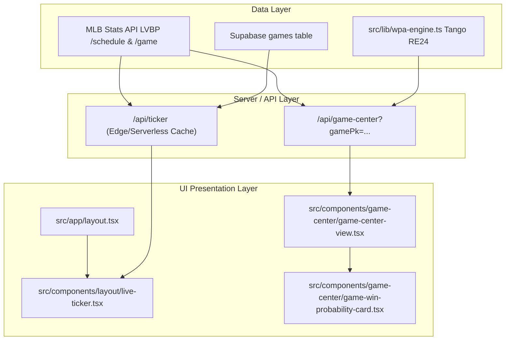

# Plan Técnico de Implementación: Ticker Superior en Vivo y Curva WPA en Game Center

**Slug:** `016-live-ticker-gamecenter-win-probability`  
**Fase:** Spec-Kit Paso 2 (Planificar)  
**Autor:** Antigravity & Jorge Leonardo Loreto  
**Fecha:** 2026-11-04  

---

## 1. Arquitectura Técnica y Estrategia

El desarrollo se descompone en dos módulos autónomos pero visualmente armonizados:



### Escalera Ponytail Aplicada
1. *¿Necesita construirse algo desde cero?* No.
   - El motor de probabilidad de victoria ya existe en [`src/lib/wpa-engine.ts`](file:///c:/Users/Administrator/Projets/republicaraquista-web/src/lib/wpa-engine.ts).
   - Los datos de partidos y calendarios ya se consumen en [`src/lib/calendar-service.ts`](file:///c:/Users/Administrator/Projets/republicaraquista-web/src/lib/calendar-service.ts) y [`src/lib/game-center-service.ts`](file:///c:/Users/Administrator/Projets/republicaraquista-web/src/lib/game-center-service.ts).
2. *¿Lo cubre la librería estándar / dependencias instaladas?*
   - Recharts (`^3.10.1`) o SVG inline determinístico: SVG inline ligero para la tarjeta del ticker y Recharts / SVG reactivo para la curva de probabilidad.
3. *Diff mínimo verificable:* Crear dos componentes UI especializados y conectar los datos existentes mediante extensiones tipadas limpias en `src/types/game-center.ts` y `src/types/ticker.ts`.

---

## 2. Archivos Afectados y Estructura

| Archivo | Responsabilidad | Operación |
|---|---|---|
| `src/types/ticker.ts` | Definición del contrato tipado de partidos del Ticker (`TickerGame`, `TickerResponse`). | **Crear** |
| `src/lib/ticker-service.ts` | Consulta del schedule oficial de la MLB Stats API (`sportId=17`) y Supabase para obtener juegos del día / ayer con marcadores y estatus. | **Crear** |
| `src/app/api/ticker/route.ts` | Endpoint HTTP de alta velocidad con caché revalidable en Vercel Edge (`s-maxage=20`). | **Crear** |
| `src/components/layout/live-ticker.tsx` | Componente de cliente con desplazamiento horizontal suave, indicador de en vivo y enlaces al Game Center. | **Crear** |
| `src/app/layout.tsx` | Integración del `<LiveTicker />` justo arriba del contenido principal. | **Modificar** |
| `src/types/game-center.ts` | Incorporar `winProbability?: GameCenterWinProbability` al payload de `GameCenterData`. | **Modificar** |
| `src/lib/game-center-service.ts` | Invocar `processGameWpa(gamePk)` y proyectar la tendencia de probabilidad y jugada clave. | **Modificar** |
| `src/components/game-center/game-win-probability-card.tsx` | Tarjeta con gráfica de curva de probabilidad de ganar, indicador de ventaja y llamada a la jugada cumbre. | **Crear** |
| `src/components/game-center/game-center-view.tsx` | Montar `GameWinProbabilityCard` en la columna izquierda de la pestaña GameCast. | **Modificar** |

---

## 3. Contratos de Datos

### A. Ticker: `src/types/ticker.ts`
```typescript
export interface TickerGameTeam {
  id: number;
  name: string;
  abbreviation: string;
  score: number;
  isLeones: boolean;
  isWinner?: boolean;
}

export interface TickerGame {
  id: number;
  gamePk: number;
  gameDate: string;
  status: "Preview" | "Live" | "Final";
  statusLabel: string; // ej: "FINAL", "ALTA 6.ª", "HOY 7:00 PM"
  isLive: boolean;
  homeTeam: TickerGameTeam;
  awayTeam: TickerGameTeam;
  currentInning?: number;
  isTopInning?: boolean;
  venue?: string;
}

export interface TickerResponse {
  success: boolean;
  dateLabel: string; // ej: "Jornada de Hoy", "Resultados de Ayer"
  games: TickerGame[];
  lastUpdated: string;
}
```

### B. Game Center WPA: `src/types/game-center.ts`
```typescript
export interface GameCenterWinProbabilityPoint {
  playIndex: number;
  inning: number;
  half: string;
  leonesWp: number; // 0.0 a 1.0 (ej: 0.68)
  description: string;
  deltaWpa: number;
}

export interface GameCenterWinProbability {
  currentLeonesWp: number;
  isLeonesHome: boolean;
  dominantTeamName: string;
  keyPlay?: {
    description: string;
    deltaWpaText: string; // ej: "+14%"
    inning: number;
    half: string;
  };
  trend: GameCenterWinProbabilityPoint[];
}
```

---

## 4. Plan de Pruebas y Validación

1. **Prueba Unitaria de Ticker Service:** Verificar que el parseador maneje correctamente estados `Final`, `Live` y `Scheduled` de la MLB Stats API.
2. **Prueba de Resiliencia en Vercel:** Validar que si la MLB API tiene retardo o no devuelve juegos para hoy, `/api/ticker` entregue los de ayer sin romper el servidor.
3. **Prueba de Curva WPA:** Verificar que un juego en vivo calcule la curva hasta el turno actual sin errores de división por cero y que el gráfico renderice el área y punto de impacto.
4. **Prueba de Build de Producción:** Ejecutar `npm run build` en Next.js para certificar cero errores de TypeScript y linting.

---

## 5. Estrategia de Rollback

En caso de cualquier problema en producción:
- Si el Ticker fallara por red externa, el componente renderiza `null` silenciosamente sin afectar la navegación ni el resto de la app.
- Si el cálculo de WPA no estuviera disponible para un juego, la tarjeta muestra el estado de inicio neutro al 50% con fallback seguro.
- Control de versiones atómico en la rama `016-live-ticker-gamecenter-win-probability`.
