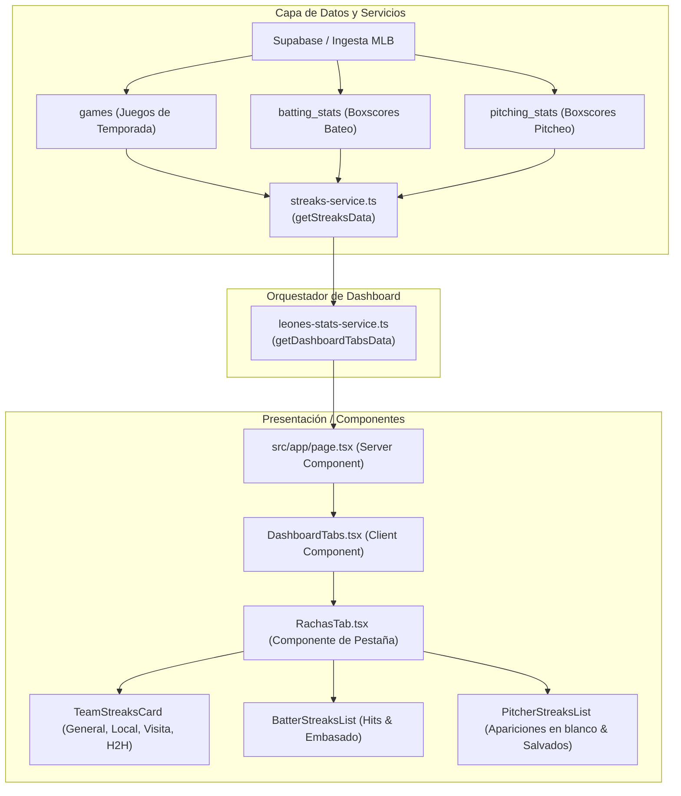

# Plan Técnico: Pestaña "Rachas" (Rachas Activas) en Centro de Mando

**Slug:** `021-rachas-activas-centro-mando`  
**Rama:** `021-rachas-activas-centro-mando`  
**Autor:** Antigravity & Jorge Leonardo Loreto (@JorgeLoreto)  
**Fecha:** 2026-11-06  
**Fase:** Spec-Kit Track 2 • Planificación Técnica  

---

## 1. Arquitectura y Flujo de Datos

---

## 2. Escalera de Simplicidad (Ponytail Senior Dev Mode)

1. **¿Se necesita construir?** Sí, el usuario y los aficionados no tienen actualmente una vista consolidada de seguidillas calientes individuales ni colectivas en Centro de Mando.
2. **¿Existe ya en el código?**
   - El cálculo de racha de equipo simple existe en `leones-stats-service.ts` (`streak = lastWon ? "${sCount} W" : "${sCount} L"`).
   - Reutilizaremos esa lógica y la extenderemos a filtros por condición (local/visita/rival).
   - Para las fotos de jugadores, ya existe la función utilitaria `getPlayerHeadshotUrl(playerId)`.
   - Para los logos y datos de rivales, ya existe `getTeam(teamId)` en `src/lib/constants.ts`.
3. **¿Lo cubre una librería existente?** `lucide-react` ya tiene los iconos `Flame`, `ShieldCheck`, `TrendingUp`, `Sparkles`, `Swords`.
4. **Diff mínimo:** Un servicio puro de cálculo (`src/lib/streaks-service.ts`), un tipo nuevo (`src/types/streaks.ts`), un componente de UI modular (`src/components/dashboard/tabs/rachas-tab.tsx`), y las extensiones mínimas en `src/types/leones-stats.ts`, `src/lib/leones-stats-service.ts` y `src/components/dashboard/dashboard-tabs.tsx`. Cero dependencias externas nuevas.

---

## 3. Archivos Afectados

| Archivo | Acción | Propósito |
|---|---|---|
| `src/types/streaks.ts` | **Crear** | Interfaces `BatterStreakItem`, `PitcherStreakItem`, `TeamStreakItem`, `RachasTabData`. |
| `src/lib/streaks-service.ts` | **Crear** | Lógica pura de cálculo de rachas de bateo, pitcheo y colectivas a partir de juegos y boxscores. |
| `src/components/dashboard/tabs/rachas-tab.tsx` | **Crear** | Vista de la pestaña con selector de categoría, tarjetas de bateadores encendidos, brazos intocables y rachas colectivas. |
| `src/types/leones-stats.ts` | **Modificar** | Añadir propiedad opcional `streaks: RachasTabData` a `DashboardTabsData`. |
| `src/lib/leones-stats-service.ts` | **Modificar** | Importar y orquestar `getStreaksData(season)` dentro de `getDashboardTabsData()`. |
| `src/components/dashboard/dashboard-tabs.tsx` | **Modificar** | Registrar la pestaña `rachas` en la 3.ª posición con icono `Flame` y renderizar `RachasTab`. |
| `tests/unit/streaks-service.test.ts` (o suite equivalente) | **Crear** | Tests unitarios para el cálculo de rachas de bateo, pitcheo y equipo. |

---

## 4. Algoritmos de Cálculo de Rachas Sabermétricas

### A. Racha de Hits (Hitting Streak)
Para cada bateador de Leones del Caracas:
1. Filtrar los boxscores de bateo (`batting_stats`) donde participó el jugador en la temporada activa, ordenados de forma cronológica descendente por fecha del juego (`game_date` / `game_id`).
2. Recorrer los juegos desde el más reciente:
   - Si el jugador tuvo al menos 1 turno oficial ($AB \ge 1$):
     - Si $H \ge 1$: sumar 1 al contador de la racha y acumular sus estadísticas ($AB, H, 2B, 3B, HR, BB, HBP$).
     - Si $H = 0$: la racha activa se corta (longitud final alcanzada).
   - Si el jugador entró solo a correr o fildear ($AB = 0, BB = 0, HBP = 0, SF = 0, SH = 0$): el juego se ignora y no rompe la racha (regla oficial MLB 9.23(b)).
3. Si la racha activa es $\ge 2$ juegos, clasifica como racha destacada.

### B. Racha de Embasado (On-Base Streak)
Similar a la racha de hits, pero la condición de éxito por juego es $(H + BB + HBP) \ge 1$.
- Corta si en un juego con al menos 1 aparición al plato ($PA \ge 1$) no se embasa por ninguna de estas vías.
- Umbral de destaque: $\ge 3$ juegos consecutivos.

### C. Racha de Apariciones sin Carreras Limpias (Lanzadores)
Para cada lanzador del club:
1. Filtrar los boxscores de pitcheo (`pitching_stats`) ordenados cronológicamente descendente.
2. Recorrer desde la última aparición:
   - Si $ER = 0$: la racha continúa (+1 juego / aparición en blanco, acumular $IP, SO, BB$).
   - Si $ER > 0$: la racha se corta.
3. Umbral de destaque: $\ge 2$ apariciones consecutivas con $0\text{ ER}$.

### D. Rachas Colectivas
1. Ordenar los juegos de Leones cronológicamente.
2. Evaluar el resultado del último juego ($W$ o $L$) y contar juegos consecutivos con el mismo resultado para:
   - Racha General.
   - Racha en casa (filtrando `home_team_id === LEONES_ID`).
   - Racha de visita (filtrando `away_team_id === LEONES_ID`).
   - Racha contra cada rival (filtrando juegos vs ese `team_id`).

---

## 5. Guardrails Constitucionales y de Dominio

1. **No romper nada:** Si `data.streaks` no está definido en tiempo de transición, `DashboardTabs` maneja fallback seguro sin crashes.
2. **Temporadas:** Usar `getActiveSeason()` para no hardcodear la temporada. Temporada 2025 o 2026 según entorno.
3. **Impeccable UI:** WCAG AA en contrastes, fuentes tipográficas mono para números, paleta oficial Navy `#0D152B` / Oro `#FDB827`, sin emojis en títulos ni botones.
4. **Idioma:** 100% en español (términos como "Juegos con Hit", "Apariciones en Blanco", "Racha Activa").

---

## 6. Plan de Rollback

Si se presenta algún comportamiento imprevisto:
1. Revertir `git checkout main` o `git reset --hard HEAD~1` en la rama de trabajo.
2. Todos los cambios están aislados en la nueva pestaña y no modifican el funcionamiento de las 4 pestañas preexistentes.
