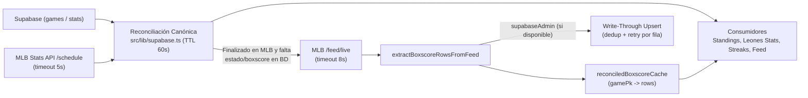

# Plan Técnico 026: Sincronización Canónica Post-Juego en Tiempo Real

**Slug:** `026-realtime-postgame-sync`  
**Fecha:** 2026-11-16  

---

## 1. Validación Constitucional y Escalera Ponytail

1. **Causa Raíz y Fuente de Verdad (`CLAUDE.md` §1, §3):**
   - La raíz del desfase reside en que `supabase.ts` y los servicios consumidores consultaban exclusivamente tablas de Supabase cuya actualización dependía de un batch externo (`update_daily.py`).
   - Se centraliza una única fuente de verdad canónica en `src/lib/supabase.ts` (`getCanonicalSeasonGames`, `getCanonicalPlayedGames`, `getCanonicalGameBoxscoreRows`) en lugar de duplicar lógica de fetch/reconciliación en cada servicio.
2. **Escalera Ponytail (`ponytail.md`):**
   - Reutilizar clientes existentes (`supabase`, `supabaseAdmin`), constantes (`ACTIVE_SEASON`, `LVBP_TEAM_IDS`, `JOSE_RONDON_ID`), utilidades de fecha (`getVenezuelanDate`, `isDayGame`) y funciones puras de cálculo (`calculatePythagorean`, `computeTeamStreaks`, `computeBatterStreaks`, `computePitcherStreaks`).
   - **Cero nuevas dependencias npm:** Se utiliza `fetch` nativo con `AbortSignal.timeout` y caché `Map` en memoria.
3. **No Regresión y Compatibilidad:**
   - Se preservan las firmas públicas de `getStandings`, `getScheduledGames`, `getRecentGames`, `getSeasonKPIs`, `getBattingStats`, `getPitchingStats`, `getLeonesAdvancedStats`, `getStreaksData` y `getTeamPlayedGames`, además de las líneas base auditadas `BASELINE_2025_STATS` y `BASELINE_2025_STREAKS`.

---

## 2. Arquitectura y Flujo de Reconciliación

---

## 3. Archivos Afectados por Track

### Track A — Capa Canónica (`src/lib/supabase.ts`)
- Exportar `FINALIZED_GAME_STATUSES`, `clearCanonicalSyncCache`, `extractBoxscoreRowsFromFeed`, `getCanonicalSeasonGames`, `getCanonicalPlayedGames` y `getCanonicalGameBoxscoreRows`.
- Implementar caché con TTL de 60s + deduplicación de promesas en vuelo, mapeo de `gameType` a fase (`regular`, `wildcard_playin`, `round_robin`, `final`), deduplicación estricta por `gamePk` con prioridad `Final > Live > Scheduled/Postponed` y `officialDate`, caché en memoria `reconciledBoxscoreCache` y write-through defensivo vía `supabaseAdmin`.
- Conectar `getStandings`, `getScheduledGames`, `getRecentGames`, `getSeasonKPIs`, `getBattingStats` y `getPitchingStats` a la capa canónica.

### Track B — Consumidores (`leones-stats-service.ts`, `streaks-service.ts`, `game-feed-service.ts`)
- `src/lib/leones-stats-service.ts`: migrar consultas de juegos a `getCanonicalPlayedGames(season, { phase: "regular", teamId: 695 })` y boxscores a `getCanonicalGameBoxscoreRows` + fallback `feed.liveData.boxscore` (incluyendo acreditación de `JOSE_RONDON_ID` y `topBatter`/`topPitcher`/`mvp`); corregir `getBroadcastChannelRecords(season)` para usar `season` dinámico y `getVenezuelanDate`.
- `src/lib/streaks-service.ts`: migrar `getStreaksData` a `getCanonicalPlayedGames` y `getCanonicalGameBoxscoreRows` manteniendo `BASELINE_2025_STREAKS`.
- `src/lib/game-feed-service.ts`: migrar `getTeamPlayedGames` a `getCanonicalPlayedGames(season, { phase: "all", teamId, includeLive: true })`.

### Track C — UI Auto-Refresh y Batch Python (`live-ticker.tsx`, `update_daily.py`)
- `src/components/layout/live-ticker.tsx`: usar `useRouter()` y `prevLiveGameIdsRef` para invocar `router.refresh()` únicamente ante transiciones `Live -> Final` sin introducir estado mutado en las dependencias de `useEffect`.
- `RepubliCaraquistApp/scripts/update_daily.py`: incluir hoy en `update_yesterdays_games(days_back=3)`, deduplicar por `gamePk` priorizando estados finalizados y ejecutar `update_game_stats(game_id)` también en `update_todays_games()`.

### Track D — Especificación y Pruebas (`specs/026-realtime-postgame-sync/`, `src/lib/__tests__/realtime-postgame-sync.test.ts`)
- Documentar `spec.md`, `plan.md`, `tasks.md` e `implementation.md`.
- Implementar pruebas deterministas con mocks de `fetch` y cliente Supabase en `src/lib/__tests__/realtime-postgame-sync.test.ts` cubriendo:
  1. Reconciliación `Scheduled/vacío -> Final` entre MLB `/schedule` y Supabase en `getCanonicalPlayedGames`, `getStandings` (`runsScored`, `runsAllowed`, `runDifferential`, `eloRating`), `getLeonesAdvancedStats`, `getHeadToHeadRecords`, `getWeeklyRecords`, `getBroadcastChannelRecords` y `getStreaksData`.
  2. Extracción y fusión sin duplicados en `extractBoxscoreRowsFromFeed` y `getCanonicalGameBoxscoreRows`, incluyendo detección de participación de José Rondón.
  3. Deduplicación de `gamePk` reprogramados/pospuestos priorizando `Final` y `officialDate`.

---

## 4. Plan de Rollback

1. Revertir los cambios por archivo mediante `git checkout -- <archivo>` o `git revert <commit>` tanto en `republicaraquista-web` como en `RepubliCaraquistApp`.
2. La base de datos Supabase no requiere migraciones DDL ni alteración de esquemas; las operaciones write-through utilizan upserts idempotentes sobre tablas existentes.
3. En caso de indisponibilidad de MLB Stats API, los timeouts de `5s`/`8s` y las cláusulas `try/catch` garantizan degradación controlada hacia los datos persistidos en Supabase.
