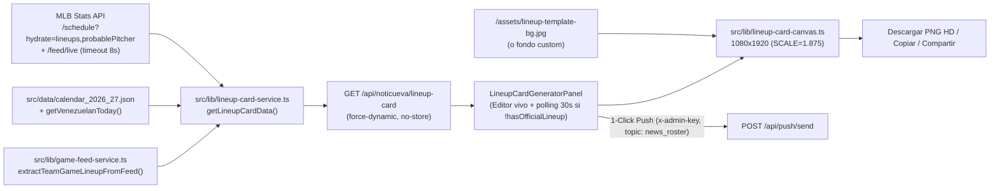

# Plan Técnico 027: Generador Admin de Tarjeta de Lineup Oficial (1080×1920 HD) y Push 1-Click

**Slug:** `027-admin-lineup-card-generator`  
**Fecha:** 2026-11-16  

---

## 1. Validación Constitucional y Escalera Ponytail

1. **Fuente de Verdad y Reutilización (`CLAUDE.md` §1, §3 y `ponytail.md`):**
   - **Extracción de alineación:** Reutilizar `extractTeamGameLineupFromFeed` de `src/lib/game-feed-service.ts` en lugar de duplicar la lógica de lectura de `battingOrder` / `boxscore.batters` / `schedule.lineups`.
   - **Calendario y fecha local VET:** Reutilizar `src/data/calendar_2026_27.json` y `getVenezuelanToday()` de `src/lib/utils.ts`.
   - **Constantes de equipos:** Reutilizar `LVBP_TEAMS` / `getTeam` de `src/lib/constants.ts`.
   - **Patrón Canvas HD y Web Push:** Seguir la convención existente de `src/lib/probabilidades-card-canvas.ts` (`HTMLCanvasElement` + `toBlob`) y el endpoint autenticado existente `POST /api/push/send` (`topic: "news_roster"`).
   - **Cero nuevas dependencias npm:** Todo el renderizado usa Canvas 2D nativo del navegador, `fetch` nativo con `AbortSignal.timeout(8000)` y pruebas con `node:assert/strict` + `npx tsx`.
2. **No Regresión y Compatibilidad:**
   - `NotiCuevaAdmin` conserva intactos todos sus formularios editoriales y `<PushBroadcastPanel adminPassword={password} />`; únicamente se inserta `<LineupCardGeneratorPanel adminPassword={password} />` encima del panel push en la vista autenticada.
   - `extractTeamGameLineupFromFeed` y `/api/push/send` no requieren modificaciones en sus firmas ni comportamientos existentes.

---

## 2. Arquitectura y Flujo de Datos

---

## 3. Archivos Afectados por Track

### Track A — Asset y Capa Backend (`public/assets/lineup-template-bg.jpg`, `src/lib/lineup-card-service.ts`, `src/app/api/noticueva/lineup-card/route.ts`)
- `public/assets/lineup-template-bg.jpg`: imagen plantilla oficial 9:16 servida estáticamente desde `/assets/lineup-template-bg.jpg`.
- `src/lib/lineup-card-service.ts`:
  - Exportar interfaces `LineupCardSlot`, `LineupCardGameOption`, `LineupCardPayload`.
  - Exportar funciones puras: `normalizeLineupPosition`, `formatOpponentShortName`, `formatShortSpanishDate`, `formatCompactTime`, `formatTransmissionLines`, `formatStadiumBannerName`, `formatPlayerDisplayName`.
  - Exportar `getLineupCardData(targetGamePk?, season = 2026)` integrando `/schedule`, `calendar_2026_27.json`, `/feed/live`, `extractTeamGameLineupFromFeed` y resolución en cascada del lanzador abridor.
- `src/app/api/noticueva/lineup-card/route.ts`:
  - `export const dynamic = "force-dynamic"`.
  - `GET(request: NextRequest)`: parsear `gamePk` y `season`, devolver `{ success: true, data }` con `Cache-Control: no-store, max-age=0`.

### Track B — Renderizador Canvas HD y UI Admin (`src/lib/lineup-card-canvas.ts`, `src/components/admin/lineup-card-generator-panel.tsx`, `src/components/noticueva/noticueva-admin.tsx`)
- `src/lib/lineup-card-canvas.ts`:
  - Exportar `LineupCardRenderData`, `LINEUP_CARD_WIDTH` (`1080`), `LINEUP_CARD_HEIGHT` (`1920`), `SCALE` (`1.875`), `ROW_CYS`, `renderLineupCardOnCanvas` y `generateLineupCardBlob`.
  - Implementar caché en memoria de `HTMLImageElement` por origen para renderizado fluido sin parpadeo y degradado de fallback si la carga de imagen falla.
- `src/components/admin/lineup-card-generator-panel.tsx`:
  - Implementar panel con selector de juegos, botón `"Sincronizar MLB API"`, selector opcional `"Cambiar fondo"`, polling de 30s controlado por `useRef` + `document.visibilityState === "visible"` cuando `isToday && !hasOfficialLineup` (respetando `isDirtyRef`), editor compacto de los 9 slots y metadatos, preview `<canvas>` `aspect-[9/16]` y 4 acciones (Descargar PNG HD, Copiar Imagen, Compartir, 1-Click Enviar Push de Lineup).
- `src/components/noticueva/noticueva-admin.tsx`:
  - Insertar `<LineupCardGeneratorPanel adminPassword={password} />` inmediatamente encima de `<PushBroadcastPanel adminPassword={password} />`.

### Track C — Spec-Kit y Pruebas (`specs/027-admin-lineup-card-generator/`, `src/lib/__tests__/lineup-card.test.ts`)
- Documentar `spec.md`, `plan.md`, `tasks.md` e `implementation.md`.
- Implementar `src/lib/__tests__/lineup-card.test.ts` usando `node:assert/strict` ejecutado con `npx tsx`, cubriendo:
  - Normalización de posiciones (`"DH" -> "BD"` y 8 posiciones estándar).
  - Nombres cortos de los 7 rivales de la LVBP.
  - Fechas cortas en español (`14NOV`, casos `OCT` y `DIC`) y horas compactas (`8:00PM`).
  - Líneas de transmisión (`TRANSMISIÓN IVC,` / `BeisbolPlay, La Mega`), banner de estadio y nombres de peloteros preservando `Ñ` (`LEANDRO CEDEÑO`, `VICTOR BERICOTO`).
  - Flujo completo `getLineupCardData` con `globalThis.fetch` mockeado para `/schedule?hydrate=lineups,probablePitcher` y `/feed/live`.

---

## 4. Plan de Rollback

1. Revertir las modificaciones en `src/components/noticueva/noticueva-admin.tsx` mediante `git checkout -- src/components/noticueva/noticueva-admin.tsx`.
2. Eliminar o revertir los nuevos archivos aislados (`public/assets/lineup-template-bg.jpg`, `src/lib/lineup-card-service.ts`, `src/app/api/noticueva/lineup-card/route.ts`, `src/lib/lineup-card-canvas.ts`, `src/components/admin/lineup-card-generator-panel.tsx`, `src/lib/__tests__/lineup-card.test.ts`).
3. No requiere migraciones de base de datos en Supabase ni cambios en variables de entorno; el panel push existente (`PushBroadcastPanel`) sigue operando de forma independiente.
