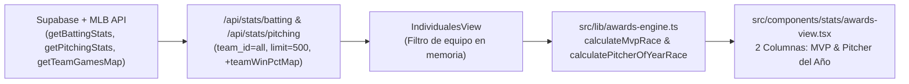

# Plan Técnico 028: Carrera por los Premios LVBP (Jugador Más Valioso y Pitcher del Año)

**Slug:** `028-awards-mvp-pitcher-tracker`  
**Fecha:** 2026-11-16

---

## 1. Validación Constitucional y Escalera Ponytail

1. **Reutilización y Fuente de Verdad (`CLAUDE.md` §1, §3 y `ponytail.md`):**
   - No crear endpoints nuevos ni migraciones de Supabase: aprovechar `getBattingStats`, `getPitchingStats` (que ya consulta MLB Stats API para pitcheo de temporada) y `getTeamGamesMap` (que ya consulta `getStandings`).
   - Reutilizar `LVBP_TEAMS`, `getTeam`, `getMlbFallbackHeadshotUrl` de `src/lib/constants.ts`.
   - Cero dependencias npm nuevas; pruebas con `node:assert/strict` + `npx tsx`.
2. **No Regresión:**
   - `getTeamGamesMap` añade `teamWinPctMap` conservando `teamGamesMap` y `maxGames` para todos los llamadores actuales.
   - `BattingTable`, `PitchingTable` y `PlayerSplitsView` mantienen exactamente su comportamiento; además, `PitchingTable` recibe por fin `gamesStarted` (`JI`) real en lugar de `0`.

---

## 2. Arquitectura y Flujo de Datos

---

## 3. Archivos Afectados

- `src/types/sports.ts`: agregar `hbp?: number` a `PitchingStats`.
- `src/lib/supabase.ts`: ampliar `fetchMlbSeasonPitchingMetaMap` (`gidp`, `wins`, `losses`, `saves`, `gamesStarted`, `hbp`), poblar en `getPitchingStats`, y agregar `teamWinPctMap` en `getTeamGamesMap`.
- `src/app/api/stats/batting/route.ts` y `src/app/api/stats/pitching/route.ts`: incluir `teamWinPctMap` y elevar `limit` por defecto a `500`.
- `src/lib/awards-engine.ts` **[NEW]**: motor determinístico con constantes dinámicas de liga, elegibilidad invernal ($\ge 3.1\text{ AP/J}$, $\ge 0.8\text{ IP/J}$) con fallback, ponderación híbrida 0–100 pts e insignias de liderato.
- `src/components/stats/awards-view.tsx` **[NEW]**: vista en dos columnas con Hero #1, callout Caraquista y tabla #2 al #10.
- `src/components/stats/stats-filters.tsx`: incluir `"awards"` en `activeTab`.
- `src/components/stats/individuales-view.tsx`: agregar pestaña **"Premios"**, deep-link `?tab=awards`/`?tab=premios`, fetch de pool completo (`limit=500`) y filtrado por equipo en memoria.
- `src/app/individuales/page.tsx`: pasar `limit = 500` e `initialTeamWinPctMap`.
- `src/lib/__tests__/awards-engine.test.ts` **[NEW]**: suite unitaria completa.
