# Plan Técnico 040: Generador Admin de Insights para X (𝕏) con Gemini y Tarjeta Dato PNG

**Slug:** `040-admin-x-insights-gemini`  
**Fecha:** 2026-11-28  

---

## 1. Validación Constitucional y Escalera Ponytail

1. **Fuente de Verdad y Reutilización (`CLAUDE.md` §1, §3 y `ponytail.md`):**
   - **Recolección de métricas LVBP:** Reutilizar los servicios canónicos existentes (`getStandings`, `getLeonesAdvancedStats`, `getLastGameDetail`, `getRecentTrends`, `getCaracasTeamLeaders`, `getHeadToHeadRecords`, `getStreaksData`, `getCollectiveStats`, `fetchSeasonWpaLeaders`) en lugar de duplicar consultas a Supabase o MLB Stats API.
   - **Autenticación Admin:** Reutilizar exactamente el mecanismo `x-admin-key` / `NOTICUEVA_ADMIN_PASSWORD` de `src/lib/noticueva-service.ts` y `src/app/api/noticueva/route.ts`.
   - **Patrón Canvas PNG:** Seguir la arquitectura existente en `src/lib/matchup-card-canvas.ts` y `src/lib/probabilidades-card-canvas.ts` (`HTMLCanvasElement`, carga segura de `/assets/logo.png`, `toBlob`).
   - **Cero nuevas dependencias npm:** Integración directa vía `fetch` nativo hacia Gemini REST API (`v1beta`), `AbortSignal.timeout(25000)`, Canvas 2D nativo y pruebas con `node:assert/strict` + `npx tsx`.
2. **No Regresión y Compatibilidad:**
   - `NotiCuevaAdmin` conserva intactos todos sus estados y acciones de NotiCueva, `<LineupCardGeneratorPanel adminPassword={password} />` y `<PushBroadcastPanel adminPassword={password} />`, organizándolos bajo un selector de 4 pestañas con `"NotiCueva"` activa por defecto.
   - Ningún servicio estadístico existente sufre cambios de firma ni de contrato.

---

## 2. Arquitectura y Flujo de Datos

```mermaid
flowchart LR
    DB["Servicios LVBP Existentes<br/>(Supabase + MLB API + WPA + Streaks)"] --> SNAP["collectLvbpContextSnapshot()<br/>Promise.allSettled + fallbacks"]
    SNAP --> PROMPT["buildXInsightsPrompt()<br/>XML blocks + 400-char sanitization"]
    PROMPT --> GEM["generateXInsightsWithGemini()<br/>gemini-3.8-flash (x-goog-api-key header, 25s)"]
    GEM --> NORM["normalizeXInsightsResponse()<br/>JSON + <=280 chars + banned-term guard"]
    NORM --> CACHE["Cache Map 5 min TTL<br/>(forceRefresh bypass)"]
    CACHE --> API["POST /api/noticueva/x-insights<br/>x-admin-key + 4s IP cooldown"]
    API --> UI["XInsightsPanel (/admin tab)<br/>sessionStorage + editores + Intent X"]
    UI --> CVS["x-insight-card-canvas.ts<br/>1200x675 & 1080x1080 PNG"]
```

---

## 3. Archivos Afectados por Track

### Track A — Entorno, Contratos, Servicio Gemini y API (`backend-gemini`)
- `.env.example`:
  - Añadir `GEMINI_API_KEY=tu-api-key-de-google-ai-studio` y `GEMINI_MODEL=gemini-3.8-flash` preservando el contenido previo.
- `src/types/x-insights.ts`:
  - Exportar `XInsightFocus`, `XInsightCardVisualData`, `XInsightDraft`, `XInsightsContextSummary`, `XInsightsRequestPayload`, `XInsightsResponseData`.
- `src/lib/x-insights-service.ts`:
  - Implementar `collectLvbpContextSnapshot(season)` con `Promise.allSettled`.
  - Exportar funciones puras: `buildXInsightsPrompt`, `normalizeXInsightsResponse`, `clearXInsightsCache` y `generateXInsightsWithGemini`.
  - Mantener caché en memoria de 5 minutos (`season:focus:normalizedManualContext`) y validación estricta de `responseMimeType: "application/json"` + `responseSchema`.
- `src/app/api/noticueva/x-insights/route.ts`:
  - `export const dynamic = "force-dynamic"`.
  - Validar `x-admin-key` (o `body.password`) contra `NOTICUEVA_ADMIN_PASSWORD`, cooldown de 4s por IP en `forceRefresh=true`, validación de `focus` (`400`), ausencia de `GEMINI_API_KEY` (`503`) y respuesta `200` `{ success: true, data }` con `Cache-Control: no-store, max-age=0`.

### Track B — Motor Canvas HD y UI Admin (`/admin`) (`ui-canvas`)
- `src/lib/x-insight-card-canvas.ts`:
  - Exportar `XInsightCardFormat` (`"landscape" | "square"`), `renderXInsightCardOnCanvas` y `generateXInsightCardBlob` para `1200×675` y `1080×1080` con estilo navy `#070B19` / `#002D62`, bordes `#1E2B4D`, acento `#FDB827`, `tabular-nums` y logo `/assets/logo.png` + `@RepubCaraquista`.
- `src/components/admin/x-insights-panel.tsx`:
  - Implementar panel con pills de enfoque, contexto manual (`<= 400` chars), resumen de contexto, 3–4 borradores editables con contador `N / 280`, dato de respaldo, sugerencia de encuesta/CTA, acciones rápidas (`Copiar texto`, `Abrir en 𝕏`, `Usar en Tarjeta PNG`), estudio Canvas PNG y persistencia en `sessionStorage` (`"noticueva_x_insights_cache"`).
- `src/components/noticueva/noticueva-admin.tsx`:
  - Añadir selector de 4 pestañas en Vista 2 (`NotiCueva` | `Insights 𝕏 (IA)` | `Tarjeta Lineup` | `Web Push`) manteniendo `NotiCueva` como predeterminada y preservando sin regresiones todo el código previo.

### Track C — Spec-Kit y Pruebas Unitarias (`speckit-tests`) + Verificación (`verifier`)
- `specs/040-admin-x-insights-gemini/`:
  - Documentar `spec.md`, `plan.md`, `tasks.md` y (tras verificación completa) `implementation.md`.
- `src/lib/__tests__/x-insights.test.ts`:
  - Pruebas unitarias ejecutables vía `npx tsx src/lib/__tests__/x-insights.test.ts` usando `node:assert/strict` cubriendo:
    1. `buildXInsightsPrompt` (bloques XML, Estadio Monumental Simón Bolívar, reglas anti-Statcast/ELO/sabermetría y truncamiento/sanitización de `manualContext`).
    2. `normalizeXInsightsResponse` (JSON válido, JSON con cercas Markdown, tope `<= 280` caracteres por tuit, saneamiento de términos prohibidos y fallbacks parciales).
    3. `generateXInsightsWithGemini` con `globalThis.fetch` mockeado (URL `models/gemini-3.8-flash:generateContent`, cabecera `x-goog-api-key` fuera de la URL, `responseMimeType: "application/json"`, manejo de errores por clave faltante / `429` / `401` / timeout, caché en memoria vs `forceRefresh=true`).

---

## 4. Plan de Rollback

1. Revertir los cambios en `src/components/noticueva/noticueva-admin.tsx` y `.env.example` mediante `git checkout -- src/components/noticueva/noticueva-admin.tsx .env.example`.
2. Eliminar o revertir los archivos nuevos aislados (`src/types/x-insights.ts`, `src/lib/x-insights-service.ts`, `src/app/api/noticueva/x-insights/route.ts`, `src/lib/x-insight-card-canvas.ts`, `src/components/admin/x-insights-panel.tsx`, `src/lib/__tests__/x-insights.test.ts`).
3. La funcionalidad existente de NotiCueva, Tarjeta Lineup y Web Push permanece intacta al no requerirse cambios en Supabase ni en las rutas previas.
